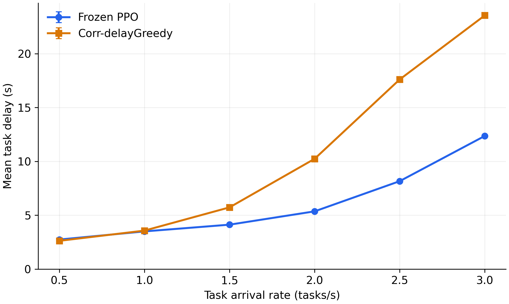

冻结 PPO 与 Corr-delayGreedy：新增到达率配对评估

新增到达率为 1.5、2.5、3.0 任务/s。每个方法在每个到达率运行 500 轮、每轮 200 个任务，共新增 600,000 个任务执行记录。

| 到达率（任务/s） | PPO 平均时延（s） | 贪心平均时延（s） | PPO 相对贪心时延降低 |
| --- | --- | --- | --- |
| 0.5 | 2.738640 | 2.621432 | -4.47% |
| 1 | 3.496510 | 3.569649 | +2.05% |
| 1.5 | 4.121593 | 5.728797 | +28.05% |
| 2 | 5.358065 | 10.236936 | +47.66% |
| 2.5 | 8.162004 | 17.608657 | +53.65% |
| 3 | 12.360930 | 23.554980 | +47.52% |

PPO 使用训练到达率为 2.0 的同一个检查点，保持随机掩码类别采样；仅冻结评估，不重新训练。新增三点使用 CPU 推理，采样种子及到达种子均为 2027。原有 0.5、1.0、2.0 三点复用历史结果。不同设备可能产生不同采样序列，新增实验的推理设备已记入参数。

每个新增场景均逐任务核对了任务属性、到达时间、安全集大小和回退标志。PPO 权重和优化器状态未变化，源检查点 SHA-256 验证通过。

两个方法在全部新增场景中的理论可靠性阈值满足率均为 91.5%，无可行组合回退比例均为 8.5%。可靠性满足率来自解析模型，不是采样执行故障后的实际成功率。

每轮重置环境，固定 200 个任务并在结束时清空副本。结果反映有限任务批次的表现，不作为稳态排队时延估计，也不是多个训练种子的平均。

趋势图误差棒表示 500 轮平均时延的一个标准误，条件为固定模型、拓扑和任务集。

新增三点汇总：comparison.csv；全部六点汇总：comparison_all_rates.csv。新增逐轮配对结果和原始轨迹目录见 status.json 中的 baseline_report。

复现命令：python results/run_additional_arrival_comparison.py
