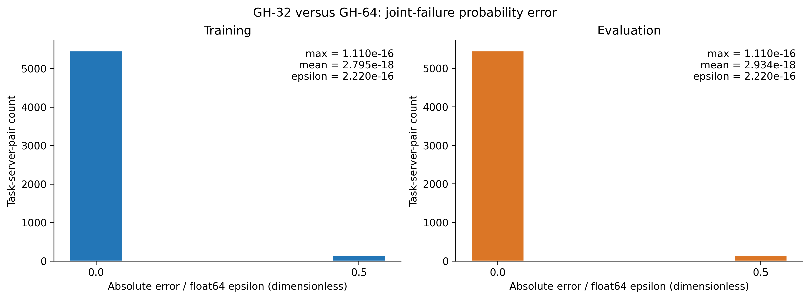
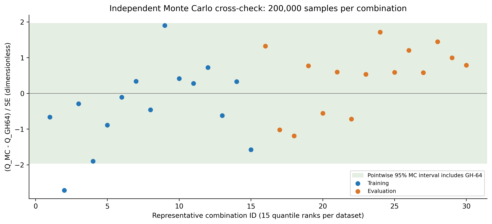
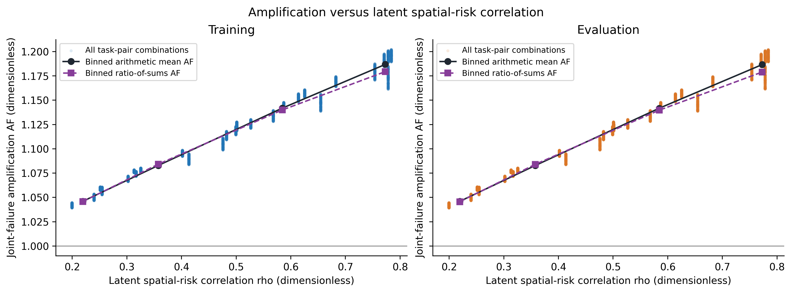
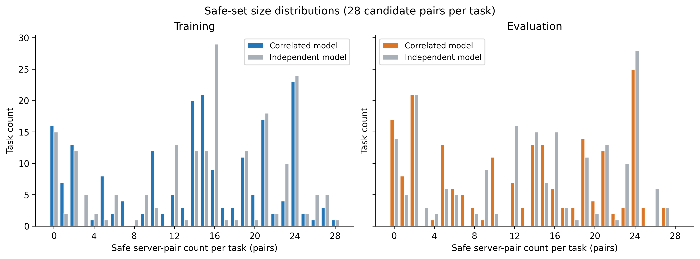
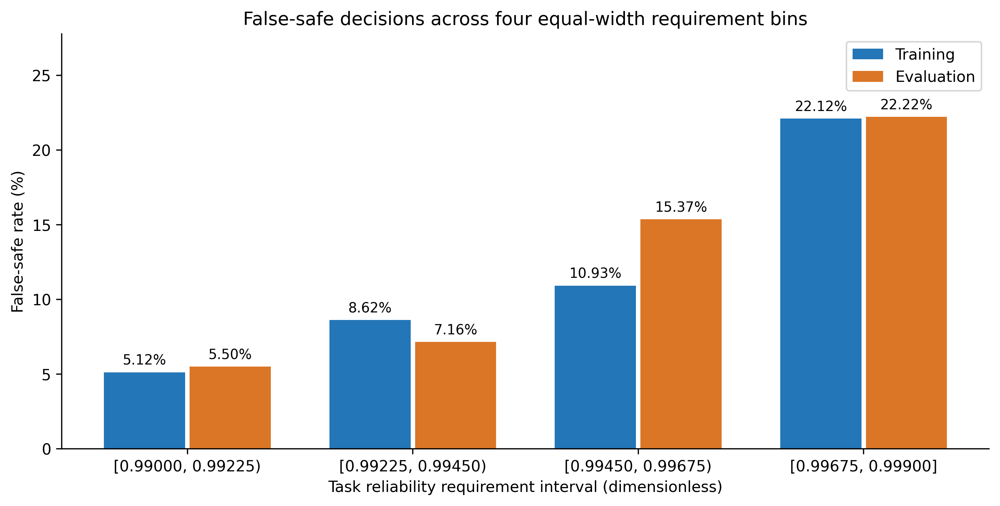

# 实验 0：GH 积分精度验证与可靠性可行性分析

## 1. 实验范围与可复现性

- 生成时间：2026-10-28T11:07:49+08:00。
- GitHub `main` 审查基准：`f663ad3612ccb60e6a9a6302434b68f422344ea8`（2026-10-28 通过 GitHub 连接器核验）；本次运行 HEAD：`f663ad3612ccb60e6a9a6302434b68f422344ea8`。
- 运行前工作区状态见文末；既有改动未参与状态、策略或执行仿真。实验仅导入配置、路径和 `core/spatial_risk.py`，不导入 PPO、Mask、奖励、任务执行或训练入口。
- 输入：现有 8 台服务器、训练集 200 个任务、评估集 200 个任务；每集 28 个无序服务器对、5600 个组合，共 11200 行。未重新生成数据。
- 风险参数：空间风险开关 `True`，β=0.5；基准相关长度 ℓ=median(d_ab)/ln(2)=0.99754466684 km。
- 潜在风险相关系数范围：[0.199424383, 0.783707404]；故障暴露窗口仅为 CPU 执行时间 C/f，单位 s。
- 任务可靠性要求范围：[0.99, 0.999]；四个等宽区间宽度为 0.00225。左闭右开，最后一组包含右端点。
- 空间相关系数使用四组固定区间：[0.00, 0.25); [0.25, 0.50); [0.50, 0.75); [0.75, 1.00]。AF 算术均值与概率总量比均记录，二者不混用。
- MC 共选取 30 个组合：每个任务集按 GH-32 的 Q_corr、任务 ID、服务器 ID 稳定排序，取 `round(linspace(0, 5599, 15))` 对应的 15 个秩，包含各集最小和最大风险。每组 M=200000；基础种子 20261028，第 k 组种子为 20261028+k−1；使用 NumPy default_rng（PCG64）。完整选择秩与种子保存在 mc_validation.csv。
- 数值类型 float64；Python 3.13.5，NumPy 2.1.3，pandas 2.2.3，matplotlib 3.10.0。图像使用真实 CSV 对应数据绘制，PNG 分辨率为 320 dpi；图中使用英文标注避免字体依赖。
- 重现命令：`python tools/experiment0_reliability_validation.py`。本次解释器：`/home/user/anaconda3/bin/python`。脚本拒绝覆盖非空输出目录；复算可指定 `--output-dir /tmp/experiment0_reproduction`。

## 2. 模型与指标公式

令 a_n=λ₀(n)C/f(n)，q_n(z)=1−exp[−a_n exp(βz−β²/2)]。潜在风险为标准高斯变量，ρ_ab=exp(−d_ab/ℓ)。ρ 是潜在风险场相关系数，不是故障事件 Pearson 相关系数。

- Q_corr=E[q_a(Z_a)q_b(Z_b)]；Q_ind=E[q_a(Z)]E[q_b(Z)]，独立模型保持相同边际分布，只去掉节点相关性。
- R_corr=1−Q_corr，R_ind=1−Q_ind；A_m(i)={(a,b):R_m(i,a,b)≥R_req(i)}。
- E_max=max|Q_corr,32−Q_corr,64|，E_mean=Σ|Q_corr,32−Q_corr,64|/(28N)。
- AF(i,a,b)=Q_corr/Q_ind；AF_overall=ΣQ_corr/ΣQ_ind，不能用逐项 AF 的平均值代替。
- ASS_m=Σ|A_m(i)|/N；ESR_m=Σ1[|A_m(i)|=0]/N；RSR_max=1−ESR_corr。
- FSR=Σ|A_ind(i)\A_corr(i)|/Σ|A_ind(i)|，分母为独立模型认可的安全动作总数。
- MC 使用独立标准正态 X、Y 及 Cholesky 变换 Z_a=X，Z_b=ρX+√(1−ρ²)Y；与 GH 的对称变换实现不同。采样对象为 q_aq_b，不是伯努利故障事件。Q_MC=mean(q_aq_b)，SE=std(q_aq_b,ddof=1)/√M，CI95=[Q_MC−1.96SE,Q_MC+1.96SE]，不裁剪区间。
- 未定义的 AF/FSR 在 CSV 中写为 `N/A`，不置为零，不纳入 AF 的有效值统计。空分组的均值和比例同样为 N/A；rho 分组仅计算 AF 等组合级指标，不将组内候选集混作完整安全集。

## 3. 实验 A：GH 数值收敛与 MC 交叉验证

| 任务集 | E_max | E_mean |
| --- | --- | --- |
| train | 1.110223e-16 | 2.795383e-18 |
| evaluation | 1.110223e-16 | 2.9341609e-18 |

全部组合 E_max=1.11022302463e-16，E_mean=2.86477191176e-18。现有公开接口返回 R，本实验保留该实现，以 Q=1−R 还原联合失败概率；因此最后几位存在消减与舍入误差。float64 epsilon 为 2.22044604925e-16。这些数字衡量 GH-32/64 的实现输出一致性，不能解释为相对于数学真值的严格误差上界。



图中横轴以 float64 epsilon 为单位，零误差也保留。误差位于浮点舍入量级，当前参数下增加求积阶数没有产生有实际意义的概率变化。

MC 检验中，GH-64 落入点态 95% 区间的组合为 **29/30**；最大标准化偏差 |Q_MC−Q_GH64|/SE 为 2.71417。存在点态 95% 区间未覆盖的组合；30 次检验本身允许少量随机未覆盖，不单独据此判定 GH 有误。 这些区间是逐组合的点态区间，不是 30 组同时覆盖区间。

| 任务集 | 组合数 | CI覆盖数 | 最大MC绝对偏差 | 平均MC绝对偏差 | 最大SE |
| --- | --- | --- | --- | --- | --- |
| train | 15 | 14 | 8.4769498e-05 | 1.4140182e-05 | 5.3775588e-05 |
| evaluation | 15 | 15 | 4.293739e-05 | 1.4623561e-05 | 5.4286887e-05 |

未覆盖组合如下；保留原始种子和结果，不更换样本以追求全部覆盖：

| 组合编号 | 任务集 | 任务ID | 服务器a | 服务器b | Q_GH64 | Q_MC | SE | CI下界 | CI上界 | 标准化偏差 |
| --- | --- | --- | --- | --- | --- | --- | --- | --- | --- | --- |
| 2 | train | 71 | 7 | 8 | 0.0019651111 | 0.0019525258 | 4.6369183e-06 | 0.0019434374 | 0.0019616141 | -2.7141661 |



绿色带表示 |Q_MC−Q_GH64|≤1.96SE。MC 与 GH 的差异必须结合采样标准误判断，不能直接拿 MC 的绝对偏差作为 GH 的积分误差。

**精度判断：当前固定数据、β 和相关长度下，GH-32 与 GH-64 的差异处于浮点舍入量级；结合独立 MC 检验，GH-32 足以用于后续当前参数下的可靠性筛选。该判断不自动外推到更大的 β 或其他参数范围。**

## 4. 实验 B：整体可行性

以下比例为 0–1 的无量纲数；N/A 表示指标未定义。

| 任务集 | AF_overall | FSR | ASS_corr | ASS_ind | ESR_corr | ESR_ind | RSR_max |
| --- | --- | --- | --- | --- | --- | --- | --- |
| train | 1.1065188 | 0.080946036 | 13.795 | 15.01 | 0.08 | 0.075 | 0.92 |
| evaluation | 1.1063152 | 0.087226277 | 12.505 | 13.7 | 0.085 | 0.07 | 0.915 |

| 任务集 | 相关安全动作总数 | 独立安全动作总数 | 错误安全动作数 | 相关空集任务数 | 独立空集任务数 |
| --- | --- | --- | --- | --- | --- |
| train | 2759 | 3002 | 243 | 16 | 15 |
| evaluation | 2501 | 2740 | 239 | 17 | 14 |

AF_overall 大于 1，说明在相同边际风险下，当前空间相关性使联合失败风险总量增加。FSR 描述独立模型候选安全动作中的错误判定比例，不是某个调度策略实际选中动作的违约率。

train 的 AF_overall=1.10651882，对应联合失效风险总量增加 10.65%；evaluation 的 AF_overall=1.10631524，对应联合失效风险总量增加 10.63%。train 的 FSR=8.0946%，独立模型比相关模型多认可 243 个安全动作，即相对相关安全动作数高估 8.8075%；evaluation 的 FSR=8.7226%，独立模型比相关模型多认可 239 个安全动作，即相对相关安全动作数高估 9.5562%。注意相对安全动作数高估率与 FSR 的分母不同。



散点包含全部任务—服务器对。实线为分组算术均值，虚线为分组概率总量比；横坐标为各组实际 rho 均值。下面给出分组统计，避免把两种聚合方式混淆。

| 任务集 | rho区间 | 组合数 | AF总量比 | AF算术均值 | AF最小值 | AF最大值 |
| --- | --- | --- | --- | --- | --- | --- |
| train | [0.00, 0.25) | 400 | 1.0457438 | 1.0460638 | 1.0392866 | 1.0535696 |
| train | [0.25, 0.50) | 2400 | 1.084188 | 1.0828835 | 1.0528442 | 1.1231144 |
| train | [0.50, 0.75) | 1800 | 1.1399737 | 1.1418403 | 1.1185704 | 1.1743566 |
| train | [0.75, 1.00] | 1000 | 1.1794024 | 1.1868405 | 1.1613381 | 1.2021779 |
| evaluation | [0.00, 0.25) | 400 | 1.045617 | 1.0460056 | 1.0392896 | 1.0536051 |
| evaluation | [0.25, 0.50) | 2400 | 1.0840211 | 1.0828183 | 1.0528475 | 1.1231584 |
| evaluation | [0.50, 0.75) | 1800 | 1.1397378 | 1.141745 | 1.1185746 | 1.1744092 |
| evaluation | [0.75, 1.00] | 1000 | 1.1790171 | 1.1866858 | 1.1613514 | 1.2022422 |

train 从最低到最高 rho 分组的 AF 总量比为 1.045744 → 1.084188 → 1.139974 → 1.179402；evaluation 从最低到最高 rho 分组的 AF 总量比为 1.045617 → 1.084021 → 1.139738 → 1.179017。当前两集的 AF 分组均值随 rho 区间增大而上升。

对固定任务和服务器边际风险，提高非负潜在相关性会提高联合失败概率。当前跨服务器对的图形还叠加了服务器异质性，分组趋势属于描述性证据，不单独等同于控制边际风险后的因果比较。



相关模型安全集包含于独立模型安全集；独立模型给出的安全动作数量偏大。零安全动作的任务在固定双副本、必须分配的规则下不可满足阈值，不能把这部分归因于策略学习失败。

## 5. 按可靠性要求分层

| 任务集 | 可靠性要求区间 | 任务数 | AF总量比 | FSR | ASS_corr | ASS_ind | ESR_corr | ESR_ind | RSR_max |
| --- | --- | --- | --- | --- | --- | --- | --- | --- | --- |
| train | [0.99000, 0.99225) | 63 | 1.1065051 | 0.051186944 | 20.301587 | 21.396825 | 0 | 0 | 1 |
| train | [0.99225, 0.99450) | 46 | 1.1061515 | 0.08625 | 15.891304 | 17.391304 | 0 | 0 | 1 |
| train | [0.99450, 0.99675) | 53 | 1.1074338 | 0.10933333 | 12.603774 | 14.150943 | 0 | 0 | 1 |
| train | [0.99675, 0.99900] | 38 | 1.1059418 | 0.22115385 | 2.1315789 | 2.7368421 | 0.42105263 | 0.39473684 | 0.57894737 |
| evaluation | [0.99000, 0.99225) | 52 | 1.1062154 | 0.054995417 | 19.826923 | 20.980769 | 0 | 0 | 1 |
| evaluation | [0.99225, 0.99450) | 56 | 1.1064154 | 0.071566731 | 17.142857 | 18.464286 | 0 | 0 | 1 |
| evaluation | [0.99450, 0.99675) | 40 | 1.1061914 | 0.15367965 | 9.775 | 11.55 | 0 | 0 | 1 |
| evaluation | [0.99675, 0.99900] | 52 | 1.1064134 | 0.22222222 | 2.2884615 | 2.9423077 | 0.32692308 | 0.26923077 | 0.67307692 |



图中的 FSR 由各分组安全动作总数计算，不对任务级 FSR 做简单平均。应结合分组任务数、ASS 与 ESR 判断严格阈值下的可行性；分组 AF 的差异也受各组任务计算量分布影响。

train 最低与最高要求组的 FSR 分别为 5.1187% 和 22.1154%；最高要求组 ESR_corr=42.1053%；evaluation 最低与最高要求组的 FSR 分别为 5.4995% 和 22.2222%；最高要求组 ESR_corr=32.6923%。当前空安全集任务集中在最高可靠性要求区间，后续算法评估应区分这一可行性限制。

## 6. 对后续 PPO 与 TORE-NET 实验的判断

当前整体 AF、非零 FSR、仍然存在的安全动作和有限 ESR，支持开展相关模型与独立模型的可靠性对比；无需先改变现有参数。但实验 0 没有调度、到达或训练，不能据此预言 PPO 优于 TORE-NET。

在相同相关模型、安全集和可靠性最大值回退下，严格使用安全集的算法应达到表中的 RSR_max。相同模型的 Corr-MPPO 与 TORE-2-Corr 应主要比较时延和资源消耗；RSR 上限由这批任务的可行性决定。FSR 非零也不保证任意策略都会实际选择错误安全动作，后续仍需记录策略选择与真实评分。

单副本可行任务比例：train=0.00%; evaluation=0.00%。当前最大单副本可靠性为 0.976558622，最低任务要求为 0.990017286。若单副本始终低于任务要求，至多双副本方法的单副本分支无法体现，单副本基线也需明确不可行时的规则。

这些结论仅适用于当前拓扑、任务集和风险模型；RSR 是理论阈值满足率，不是实际故障采样的成功率。MC 检验服务于期望积分校验，并未新增真实任务故障或修改执行机制。

## 7. 数据文件与源文件审计

- `gh_accuracy.csv`：11200 行，全量 GH-32/64 联合失败概率与绝对误差。
- `mc_validation.csv`：30 行，分位点选择、种子、GH-64、MC、SE、点态 CI 与覆盖标记。
- `pair_reliability.csv`：11200 行，逐组合输入、边际可靠性、相关性、Q/R、AF、安全标记和分组编号。
- `feasibility.csv`：400 行，逐任务安全集、空集、错误安全动作和最大可靠性。
- `summary.csv`：18 行，整体、可靠性要求分组、rho 分组；分组编号均从 0 开始。rho 分组的安全集指标为 N/A（不适用）。
- `figures/`：上述五张 PNG，均为 320 dpi。

运行前工作区状态（实验未修改这些既有文件）：

```text
M Project_main.py
 M config/params.py
 M core/env_state.py
```

以下 SHA-256 在计算前取得，并在输出前重新核对一致，用于确认输入和复用模块未被实验修改：

| 文件 | SHA-256 |
| --- | --- |
| data/server_info.xlsx | `e9045d8b89bf1ef47aeafdd13e66a7e6224c11944e48f9e7edf7ec4f6ac72ba9` |
| data/task_parameters.xlsx | `77b0ce9ab94e56140652808ba6a23d1d0d7686e0e943424c4d5b54782871aa20` |
| data/task_parameters_evaluation.xlsx | `72f7883cf0219b9ec433c528e937702710f826bde34fdd9c7937bc475415263c` |
| core/spatial_risk.py | `3965b31f344cee04884310b2c7a4d5b77e1c305222410af6aeabd0a05d9230ce` |
| config/configuration.py | `f3bb49cb2cb7c21991fdacf3436575c56e26aa95b0f380494f6b0dbebf2da6df` |
| config/paths.py | `69d1b393852b412b74172aac50fdd95bb8da0ca3f7378239eeccebeeca5b9eaf` |
| tools/experiment0_reliability_validation.py | `3e283d08dc143c2e49b26eace850889ecca59478aed1c14a9c2108be78c6923b` |
