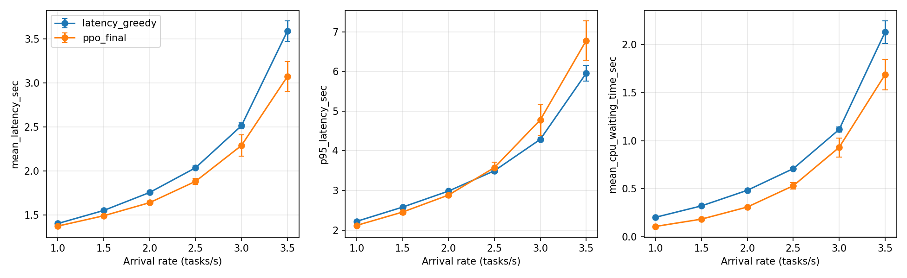

# 当前配置：PPO与Latency Greedy六档对比

CPU运行；每率10种子×300训练轮×20评估轮。最终模型冻结，PPO按概率采样，无模型选择或调参。
42维；CPU 1–4 GHz，上传5–20 MB/s，任务计算需求2–4×10⁹ cycles，任务大小5–10 MB；运行与等待工作量直接使用秒数。
gamma=0.8（按秒折扣），GAE lambda=0.95；单任务负延迟回填。空间风险开启=True，可靠性不筛选动作或惩罚奖励。
Greedy从相同状态还原物理量，预测max(上传,运行＋等待)+执行；组合按最小副本时间、两副本时间之和、编号排序。不观察在途或未来任务。
训练和评估使用独立固定任务集。两方法使用相同任务、到达和空间场；所有400副本排空。每种子先平均20评估轮，再配对训练种子，计算t区间。改善率逐种子计算后平均。区间为探索性逐指标比较，未作多重比较校正。

| 到达率 | PPO平均延迟(s) | Greedy平均延迟(s) | 改善率(%) | PPO−Greedy 95% CI(s) |
|---|---:|---:|---:|---|
| 1 | 1.371994 | 1.400993 | 2.069 | [-0.038607, -0.019391] |
| 1.5 | 1.489428 | 1.549678 | 3.887 | [-0.070340, -0.050159] |
| 2 | 1.638312 | 1.754121 | 6.601 | [-0.127266, -0.104352] |
| 2.5 | 1.880686 | 2.035065 | 7.586 | [-0.175496, -0.133262] |
| 3 | 2.288336 | 2.513212 | 8.959 | [-0.302661, -0.147091] |
| 3.5 | 3.072470 | 3.588762 | 14.401 | [-0.604847, -0.427737] |

命令：`python compare_ppo_greedy.py`

## 结果与核验

六档平均延迟的PPO−Greedy配对95%区间均低于零，每档10/10种子平均延迟更低；平均CPU等待时间也均有改善证据。P95在1/1.5/2下更低，2.5下区间跨零，3/3.5下更高。不能称所有延迟指标全面优于Greedy。

60个独立模型从头训练，共18000训练Episode、2400评估Episode（每种方法1200轮）；120份初始/最终checkpoint。每个最终模型42维、有限权重、Actor/Critic各2400次小批次优化。所有Episode动作计数为200，平均延迟分解及奖励和通过核验；全部配对统计独立重算一致。输入数据、配置和执行代码哈希未变。

评估任务名义负载率依次为27.96%、41.94%、55.92%、69.90%、83.88%、97.86%。这是每轮200任务并排空两副本的有限任务集实验，不表示长期稳态或其他参数下的普遍优势。

| 到达率 | PPO P95(s) | Greedy P95(s) | PPO−Greedy 95% CI(s) |
|---|---:|---:|---|
| 1 | 2.118149 | 2.220619 | [-0.136888, -0.068053] |
| 1.5 | 2.454481 | 2.579538 | [-0.174125, -0.075989] |
| 2 | 2.883400 | 2.983679 | [-0.141739, -0.058819] |
| 2.5 | 3.576549 | 3.495990 | [-0.020636, 0.181753] |
| 3 | 4.780320 | 4.289380 | [0.222986, 0.758895] |
| 3.5 | 6.779471 | 5.955740 | [0.541649, 1.105813] |
