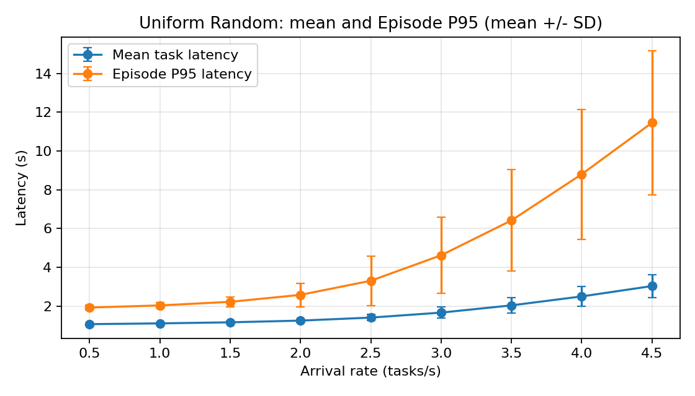
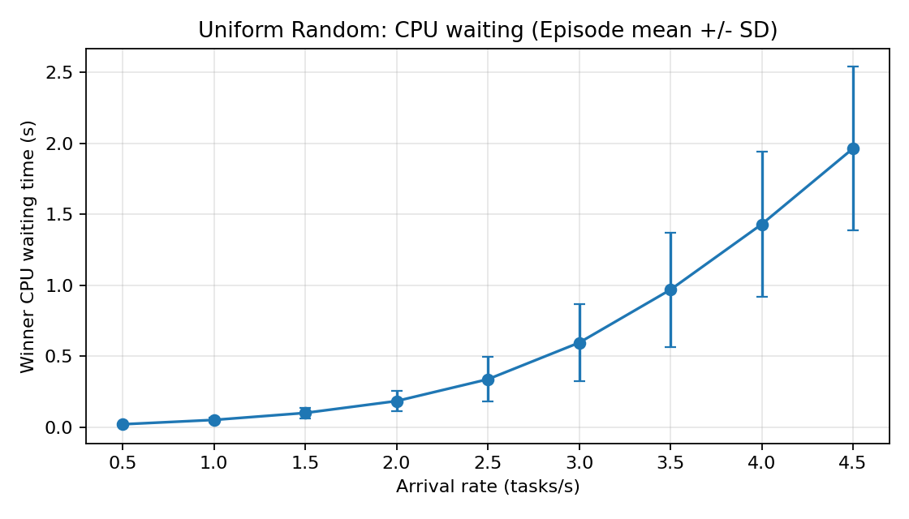
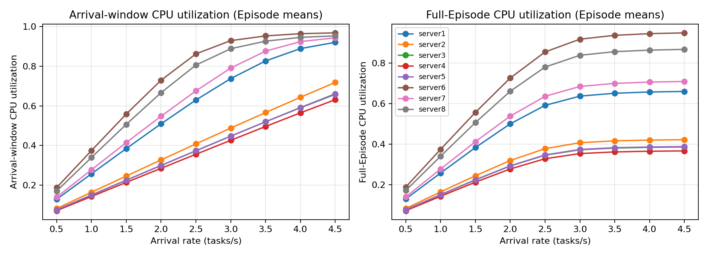
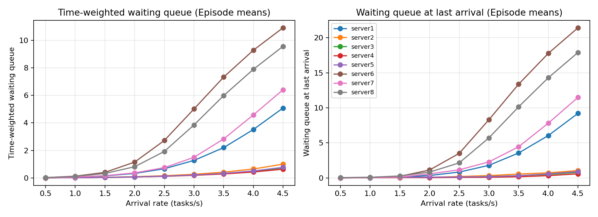

# Step 5：Uniform Random 负载扫描与服务器排队性能分析

## A. 代码与实验版本

基准：`main@2bfd1255481d544b9d860fd130a8d5f002b4d267`。仅新增独立扫描脚本与本目录结果；输入 Excel、核心执行、风险模型、41 维状态和 PPO 均保留。
Python 3.10.19；NumPy 2.2.6；pandas 2.3.3；SimPy 4.1.1；matplotlib 3.10.8。
固定种子 2026；每个 Episode e 独立派生 SeedSequence (5,e,0)/(5,e,1)/(5,e,2)，分别生成 Exp(1) 到达基础数、均匀动作索引、标准高斯向量。
不同到达率复用同一 Episode 的三个基础轨迹，间隔为 X/lambda；不重置全局 np.random.seed，不创建 MainLoop 实例或调用 PPO。
命令：`/home/user/anaconda3/envs/DRL-reliable-offloading-simulator/bin/python tools/scan_random_load.py`；正式配置为 100 Episodes/到达率，200 固定任务/Episode。

## B. 数据与负载参数

固定源：data/server_info.xlsx、data/task_parameters.xlsx；服务器按 Server_ID、任务按 Task_ID 排序，复用 MainLoop 静态 profile builders 和动作字典序。
CPU 为 cycles/s，上传速率为 MB/s：

| Server_ID | Site_ID | Processing_Frequency | Transmission_Rate |
| --- | --- | --- | --- |
| 1 | 11571 | 1.6568133e+09 | 17.609381 |
| 2 | 11579 | 2.5773507e+09 | 26.93796 |
| 3 | 11581 | 2.8889997e+09 | 29.519905 |
| 4 | 11590 | 2.9957337e+09 | 28.721468 |
| 5 | 11591 | 2.8760382e+09 | 17.216003 |
| 6 | 44125 | 1.1730054e+09 | 22.959264 |
| 7 | 130439 | 1.6029704e+09 | 29.710143 |
| 8 | 304434 | 1.2937316e+09 | 20.963089 |

平均需求 C_bar=1759178105.600922584534 cycles；f_min=1173005399.631190061569 cycles/s；lambda_crit=4*f_min/C_bar=2.667166890940 tasks/s。
最大扫描值=0.5*ceil((lambda_crit+1.5)/0.5)=4.5；扫描列表：[0.5, 1.0, 1.5, 2.0, 2.5, 3.0, 3.5, 4.0, 4.5]。
lambda_crit 是均匀选择下平均工作量的稳态参考，不是有限 200 任务系统的硬容量界限。
beta=0.5；ell_0=0.997544666840 km，由当前坐标计算；风险场经现有函数映射到有效故障率。
风险只用于条件理论可靠性计算，没有实际失败事件、动作 Mask 或取消副本，不改变物理延迟。
28 对的经验动作频数范围 668–765，每对理论期望 714.285714；每个动作通过独立 RNG integers(28) 等概率抽样。

## C. Episode 级任务延迟：Mean ± SD

每个 Episode 先算 200 个任务的均值与 P95（NumPy 默认线性百分位），再跨 Episode 汇总；SD 使用 ddof=1，不使用 pooled P95。
获胜副本以最早 finish 决定（完全相同时按 replica_A 优先），上传/等待/执行分解来自实际时间戳；另一个副本继续消耗 CPU。

| arrival_rate | mean_latency_sec | p95_latency_sec | mean_upload_time_sec | mean_cpu_waiting_time_sec | mean_cpu_execution_time_sec |
| --- | --- | --- | --- | --- | --- |
| 0.5 | 1.063031 ± 0.023741 | 1.920894 ± 0.119187 | 0.305373 ± 0.005295 | 0.019145 ± 0.008214 | 0.738513 ± 0.019965 |
| 1 | 1.102655 ± 0.031313 | 2.029009 ± 0.145592 | 0.307038 ± 0.005160 | 0.049805 ± 0.017007 | 0.745812 ± 0.021383 |
| 1.5 | 1.157856 ± 0.049793 | 2.214499 ± 0.261106 | 0.308520 ± 0.005146 | 0.099071 ± 0.037419 | 0.750265 ± 0.021252 |
| 2 | 1.245646 ± 0.083418 | 2.572936 ± 0.606017 | 0.309974 ± 0.005115 | 0.182774 ± 0.073389 | 0.752899 ± 0.019868 |
| 2.5 | 1.400552 ± 0.165348 | 3.301771 ± 1.278525 | 0.311321 ± 0.005258 | 0.336222 ± 0.155837 | 0.753009 ± 0.019680 |
| 3 | 1.658089 ± 0.279075 | 4.614578 ± 1.962590 | 0.312636 ± 0.005321 | 0.593979 ± 0.269401 | 0.751473 ± 0.018807 |
| 3.5 | 2.031449 ± 0.412365 | 6.411555 ± 2.613677 | 0.313942 ± 0.005775 | 0.967463 ± 0.401838 | 0.750044 ± 0.019170 |
| 4 | 2.493107 ± 0.521331 | 8.795667 ± 3.351964 | 0.314801 ± 0.005926 | 1.428894 ± 0.509251 | 0.749412 ± 0.018227 |
| 4.5 | 3.027612 ± 0.591753 | 11.451141 ± 3.718523 | 0.315479 ± 0.005708 | 1.963087 ± 0.578685 | 0.749046 ± 0.018877 |

## D. 服务器 CPU 与排队

到达窗口 [0,T_arr]，T_arr 为第 200 个任务到达时间；完整窗口 [0,T_end]，T_end 为全部 400 个副本的最大 finish。
实际 CPU 忙碌区间与各窗口取交集；分配工作量单独记录，不当成到达窗口利用率。
等待区间采用 [queue_enter,cpu_start)，零时长等待排除，同一时刻的进入/退出先合并再更新队列数。
时间加权队列均值为等待区间与到达窗口交集长度之和/T_arr；最大队列与末次到达积压仅包含已上传完、未开始 CPU 的副本。
末次到达快照采用该时刻先前 CPU 事件已处理完的半开区间语义；当前第 200 个任务还没有上传结果。在途副本不计入。
所有表项均为先按 Episode 计算，再跨 Episode 汇总的 mean±SD；副本数单位为个、工作量为秒、利用率为比例。

### 到达率 0.5 tasks/s

| server_id | rho_reference | cpu_utilization_arrival | cpu_utilization_full | mean_waiting_queue_length | max_waiting_queue_length | waiting_queue_length_at_last_arrival | replica_count | assigned_cpu_work_sec |
| --- | --- | --- | --- | --- | --- | --- | --- | --- |
| 1 | 0.13272302 | 0.128919 ± 0.018908 | 0.129470 ± 0.018799 | 0.011042 ± 0.006540 | 1.390000 ± 0.548552 | 0.010000 ± 0.100000 | 49.460000 ± 6.077646 | 52.239701 ± 6.698164 |
| 2 | 0.08531911 | 0.082313 ± 0.010230 | 0.082518 ± 0.010172 | 0.003817 ± 0.002707 | 1.100000 ± 0.389249 | 0.000000 ± 0.000000 | 48.570000 ± 5.019668 | 33.340308 ± 3.854639 |
| 3 | 0.076115363 | 0.075213 ± 0.010102 | 0.075541 ± 0.010112 | 0.003538 ± 0.002669 | 1.120000 ± 0.432984 | 0.000000 ± 0.000000 | 50.110000 ± 5.816895 | 30.493092 ± 3.698447 |
| 4 | 0.073403474 | 0.071612 ± 0.011661 | 0.071749 ± 0.011615 | 0.003206 ± 0.002464 | 1.120000 ± 0.356186 | 0.000000 ± 0.000000 | 48.900000 ± 6.317364 | 28.942040 ± 4.228795 |
| 5 | 0.076458394 | 0.075424 ± 0.011967 | 0.075795 ± 0.011938 | 0.003713 ± 0.002687 | 1.120000 ± 0.455716 | 0.000000 ± 0.000000 | 50.310000 ± 6.787831 | 30.583851 ± 4.360024 |
| 6 | 0.18746483 | 0.187704 ± 0.027809 | 0.188162 ± 0.027744 | 0.024940 ± 0.012807 | 1.690000 ± 0.646592 | 0.040000 ± 0.242878 | 51.190000 ± 6.458406 | 75.920555 ± 9.825630 |
| 7 | 0.13718111 | 0.139065 ± 0.020333 | 0.139283 ± 0.020208 | 0.012777 ± 0.007603 | 1.400000 ± 0.586033 | 0.000000 ± 0.000000 | 50.630000 ± 5.445144 | 56.144021 ± 6.911962 |
| 8 | 0.16997132 | 0.170240 ± 0.026775 | 0.171101 ± 0.026667 | 0.021055 ± 0.012526 | 1.590000 ± 0.621094 | 0.030000 ± 0.171447 | 50.830000 ± 6.416606 | 69.087139 ± 10.182747 |

### 到达率 1.0 tasks/s

| server_id | rho_reference | cpu_utilization_arrival | cpu_utilization_full | mean_waiting_queue_length | max_waiting_queue_length | waiting_queue_length_at_last_arrival | replica_count | assigned_cpu_work_sec |
| --- | --- | --- | --- | --- | --- | --- | --- | --- |
| 1 | 0.26544604 | 0.257409 ± 0.037780 | 0.257442 ± 0.037498 | 0.054689 ± 0.033244 | 2.020000 ± 0.778239 | 0.000000 ± 0.000000 | 49.460000 ± 6.077646 | 52.239701 ± 6.698164 |
| 2 | 0.17063822 | 0.164408 ± 0.020462 | 0.164064 ± 0.020188 | 0.017470 ± 0.011288 | 1.430000 ± 0.555141 | 0.010000 ± 0.100000 | 48.570000 ± 5.019668 | 33.340308 ± 3.854639 |
| 3 | 0.15223073 | 0.150203 ± 0.020115 | 0.150183 ± 0.019993 | 0.015024 ± 0.008747 | 1.510000 ± 0.611258 | 0.030000 ± 0.171447 | 50.110000 ± 5.816895 | 30.493092 ± 3.698447 |
| 4 | 0.14680695 | 0.142995 ± 0.023209 | 0.142656 ± 0.023095 | 0.013756 ± 0.007709 | 1.340000 ± 0.496859 | 0.030000 ± 0.222702 | 48.900000 ± 6.317364 | 28.942040 ± 4.228795 |
| 5 | 0.15291679 | 0.150517 ± 0.023887 | 0.150691 ± 0.023667 | 0.015076 ± 0.009291 | 1.470000 ± 0.558768 | 0.030000 ± 0.171447 | 50.310000 ± 6.787831 | 30.583851 ± 4.360024 |
| 6 | 0.37492967 | 0.374422 ± 0.055501 | 0.374082 ± 0.054896 | 0.126211 ± 0.064357 | 2.540000 ± 0.869459 | 0.080000 ± 0.367355 | 51.190000 ± 6.458406 | 75.920555 ± 9.825630 |
| 7 | 0.27436222 | 0.277679 ± 0.040765 | 0.276921 ± 0.040114 | 0.060761 ± 0.030749 | 2.090000 ± 0.842015 | 0.020000 ± 0.140705 | 50.630000 ± 5.445144 | 56.144021 ± 6.911962 |
| 8 | 0.33994264 | 0.339458 ± 0.053646 | 0.340194 ± 0.053001 | 0.105071 ± 0.057773 | 2.360000 ± 0.847098 | 0.080000 ± 0.338744 | 50.830000 ± 6.416606 | 69.087139 ± 10.182747 |

### 到达率 1.5 tasks/s

| server_id | rho_reference | cpu_utilization_arrival | cpu_utilization_full | mean_waiting_queue_length | max_waiting_queue_length | waiting_queue_length_at_last_arrival | replica_count | assigned_cpu_work_sec |
| --- | --- | --- | --- | --- | --- | --- | --- | --- |
| 1 | 0.39816906 | 0.384666 ± 0.056212 | 0.382982 ± 0.055690 | 0.146966 ± 0.100885 | 2.650000 ± 0.914253 | 0.110000 ± 0.345096 | 49.460000 ± 6.077646 | 52.239701 ± 6.698164 |
| 2 | 0.25595733 | 0.246219 ± 0.030687 | 0.244051 ± 0.029812 | 0.044293 ± 0.028403 | 1.900000 ± 0.731679 | 0.050000 ± 0.261116 | 48.570000 ± 5.019668 | 33.340308 ± 3.854639 |
| 3 | 0.22834609 | 0.224940 ± 0.030032 | 0.223410 ± 0.029628 | 0.036504 ± 0.018897 | 1.780000 ± 0.675397 | 0.050000 ± 0.219043 | 50.110000 ± 5.816895 | 30.493092 ± 3.698447 |
| 4 | 0.22021042 | 0.214161 ± 0.034607 | 0.212261 ± 0.034546 | 0.033918 ± 0.016869 | 1.750000 ± 0.625631 | 0.050000 ± 0.261116 | 48.900000 ± 6.317364 | 28.942040 ± 4.228795 |
| 5 | 0.22937518 | 0.225250 ± 0.035726 | 0.224171 ± 0.035110 | 0.036894 ± 0.020401 | 1.710000 ± 0.624338 | 0.080000 ± 0.272660 | 50.310000 ± 6.787831 | 30.583851 ± 4.360024 |
| 6 | 0.5623945 | 0.558780 ± 0.082798 | 0.556418 ± 0.081029 | 0.402786 ± 0.252678 | 3.600000 ± 1.189177 | 0.230000 ± 0.600589 | 51.190000 ± 6.458406 | 75.920555 ± 9.825630 |
| 7 | 0.41154333 | 0.414867 ± 0.061142 | 0.411932 ± 0.059470 | 0.165081 ± 0.089541 | 2.720000 ± 0.954310 | 0.110000 ± 0.399368 | 50.630000 ± 5.445144 | 56.144021 ± 6.911962 |
| 8 | 0.50991396 | 0.506662 ± 0.080196 | 0.506049 ± 0.078589 | 0.321372 ± 0.224747 | 3.350000 ± 1.258306 | 0.280000 ± 0.739642 | 50.830000 ± 6.416606 | 69.087139 ± 10.182747 |

### 到达率 2.0 tasks/s

| server_id | rho_reference | cpu_utilization_arrival | cpu_utilization_full | mean_waiting_queue_length | max_waiting_queue_length | waiting_queue_length_at_last_arrival | replica_count | assigned_cpu_work_sec |
| --- | --- | --- | --- | --- | --- | --- | --- | --- |
| 1 | 0.53089208 | 0.509590 ± 0.074248 | 0.499895 ± 0.070094 | 0.325442 ± 0.247267 | 3.280000 ± 1.303298 | 0.340000 ± 0.806789 | 49.460000 ± 6.077646 | 52.239701 ± 6.698164 |
| 2 | 0.34127644 | 0.327613 ± 0.040764 | 0.318899 ± 0.039757 | 0.089955 ± 0.057047 | 2.300000 ± 0.858705 | 0.070000 ± 0.293189 | 48.570000 ± 5.019668 | 33.340308 ± 3.854639 |
| 3 | 0.30446145 | 0.299419 ± 0.039908 | 0.291957 ± 0.039678 | 0.071346 ± 0.032450 | 2.260000 ± 0.746980 | 0.070000 ± 0.256432 | 50.110000 ± 5.816895 | 30.493092 ± 3.698447 |
| 4 | 0.2936139 | 0.285122 ± 0.045924 | 0.277344 ± 0.045655 | 0.066236 ± 0.031738 | 2.050000 ± 0.687184 | 0.040000 ± 0.242878 | 48.900000 ± 6.317364 | 28.942040 ± 4.228795 |
| 5 | 0.30583358 | 0.299660 ± 0.047295 | 0.292842 ± 0.046166 | 0.074303 ± 0.039898 | 2.170000 ± 0.739301 | 0.110000 ± 0.345096 | 50.310000 ± 6.787831 | 30.583851 ± 4.360024 |
| 6 | 0.74985934 | 0.729390 ± 0.096097 | 0.725714 ± 0.096876 | 1.149670 ± 0.993647 | 5.190000 ± 1.998459 | 1.120000 ± 1.713169 | 51.190000 ± 6.458406 | 75.920555 ± 9.825630 |
| 7 | 0.54872444 | 0.547823 ± 0.079849 | 0.537885 ± 0.076494 | 0.365464 ± 0.199772 | 3.450000 ± 1.166667 | 0.570000 ± 1.148165 | 50.630000 ± 5.445144 | 56.144021 ± 6.911962 |
| 8 | 0.67988529 | 0.666589 ± 0.101023 | 0.660333 ± 0.097836 | 0.812546 ± 0.679302 | 4.520000 ± 1.940946 | 0.820000 ± 1.506752 | 50.830000 ± 6.416606 | 69.087139 ± 10.182747 |

### 到达率 2.5 tasks/s

| server_id | rho_reference | cpu_utilization_arrival | cpu_utilization_full | mean_waiting_queue_length | max_waiting_queue_length | waiting_queue_length_at_last_arrival | replica_count | assigned_cpu_work_sec |
| --- | --- | --- | --- | --- | --- | --- | --- | --- |
| 1 | 0.6636151 | 0.629464 ± 0.089592 | 0.590817 ± 0.085868 | 0.667665 ± 0.549406 | 4.220000 ± 1.726677 | 0.830000 ± 1.255734 | 49.460000 ± 6.077646 | 52.239701 ± 6.698164 |
| 2 | 0.42659555 | 0.408228 ± 0.050447 | 0.377462 ± 0.053017 | 0.159809 ± 0.096853 | 2.690000 ± 1.041512 | 0.200000 ± 0.586033 | 48.570000 ± 5.019668 | 33.340308 ± 3.854639 |
| 3 | 0.38057682 | 0.373501 ± 0.049736 | 0.345174 ± 0.049343 | 0.124861 ± 0.055279 | 2.540000 ± 0.845905 | 0.090000 ± 0.287623 | 50.110000 ± 5.816895 | 30.493092 ± 3.698447 |
| 4 | 0.36701737 | 0.355961 ± 0.057293 | 0.327792 ± 0.055830 | 0.115631 ± 0.058014 | 2.450000 ± 0.715979 | 0.070000 ± 0.256432 | 48.900000 ± 6.317364 | 28.942040 ± 4.228795 |
| 5 | 0.38229197 | 0.373706 ± 0.058744 | 0.346400 ± 0.058579 | 0.128431 ± 0.069485 | 2.440000 ± 0.808040 | 0.120000 ± 0.432984 | 50.310000 ± 6.787831 | 30.583851 ± 4.360024 |
| 6 | 0.93732417 | 0.861991 ± 0.082957 | 0.854104 ± 0.087181 | 2.719978 ± 2.191646 | 7.690000 ± 3.486467 | 3.500000 ± 3.970853 | 51.190000 ± 6.458406 | 75.920555 ± 9.825630 |
| 7 | 0.68590555 | 0.675363 ± 0.097263 | 0.635468 ± 0.092307 | 0.745920 ± 0.481201 | 4.350000 ± 1.539874 | 1.150000 ± 1.665909 | 50.630000 ± 5.445144 | 56.144021 ± 6.911962 |
| 8 | 0.84985661 | 0.805488 ± 0.106581 | 0.779589 ± 0.112862 | 1.924247 ± 1.633557 | 6.340000 ± 2.941243 | 2.140000 ± 2.821347 | 50.830000 ± 6.416606 | 69.087139 ± 10.182747 |

### 到达率 3.0 tasks/s

| server_id | rho_reference | cpu_utilization_arrival | cpu_utilization_full | mean_waiting_queue_length | max_waiting_queue_length | waiting_queue_length_at_last_arrival | replica_count | assigned_cpu_work_sec |
| --- | --- | --- | --- | --- | --- | --- | --- | --- |
| 1 | 0.79633812 | 0.737579 ± 0.096346 | 0.636324 ± 0.098741 | 1.271630 ± 1.040929 | 5.470000 ± 2.307016 | 1.790000 ± 2.212430 | 49.460000 ± 6.077646 | 52.239701 ± 6.698164 |
| 2 | 0.51191466 | 0.487938 ± 0.059730 | 0.406762 ± 0.062969 | 0.265037 ± 0.155632 | 3.010000 ± 1.105496 | 0.320000 ± 0.839432 | 48.570000 ± 5.019668 | 33.340308 ± 3.854639 |
| 3 | 0.45669218 | 0.447025 ± 0.059506 | 0.371992 ± 0.058698 | 0.205988 ± 0.097835 | 2.960000 ± 0.983911 | 0.190000 ± 0.506423 | 50.110000 ± 5.816895 | 30.493092 ± 3.698447 |
| 4 | 0.44042084 | 0.426282 ± 0.068810 | 0.353203 ± 0.064656 | 0.189084 ± 0.102373 | 2.820000 ± 0.936143 | 0.090000 ± 0.287623 | 48.900000 ± 6.317364 | 28.942040 ± 4.228795 |
| 5 | 0.45875037 | 0.447247 ± 0.069868 | 0.373435 ± 0.069345 | 0.211024 ± 0.118639 | 2.860000 ± 0.921352 | 0.180000 ± 0.538985 | 50.310000 ± 6.787831 | 30.583851 ± 4.360024 |
| 6 | 1.124789 | 0.928854 ± 0.060042 | 0.916962 ± 0.078750 | 5.011891 ± 3.133326 | 11.210000 ± 5.154766 | 8.300000 ± 5.712824 | 51.190000 ± 6.458406 | 75.920555 ± 9.825630 |
| 7 | 0.82308666 | 0.790701 ± 0.106300 | 0.684082 ± 0.105242 | 1.496450 ± 1.133550 | 5.720000 ± 2.318481 | 2.280000 ± 2.340163 | 50.630000 ± 5.445144 | 56.144021 ± 6.911962 |
| 8 | 1.0198279 | 0.888096 ± 0.082179 | 0.837777 ± 0.117101 | 3.851254 ± 2.692044 | 9.170000 ± 4.245152 | 5.710000 ± 4.466022 | 50.830000 ± 6.416606 | 69.087139 ± 10.182747 |

### 到达率 3.5 tasks/s

| server_id | rho_reference | cpu_utilization_arrival | cpu_utilization_full | mean_waiting_queue_length | max_waiting_queue_length | waiting_queue_length_at_last_arrival | replica_count | assigned_cpu_work_sec |
| --- | --- | --- | --- | --- | --- | --- | --- | --- |
| 1 | 0.92906114 | 0.826508 ± 0.090717 | 0.650615 ± 0.105876 | 2.202526 ± 1.722877 | 7.030000 ± 3.073034 | 3.550000 ± 3.537319 | 49.460000 ± 6.077646 | 52.239701 ± 6.698164 |
| 2 | 0.59723377 | 0.566248 ± 0.068566 | 0.415835 ± 0.066801 | 0.418904 ± 0.247726 | 3.550000 ± 1.297823 | 0.550000 ± 1.157976 | 48.570000 ± 5.019668 | 33.340308 ± 3.854639 |
| 3 | 0.53280754 | 0.519768 ± 0.068593 | 0.380442 ± 0.063060 | 0.320702 ± 0.161760 | 3.350000 ± 1.192358 | 0.320000 ± 0.664846 | 50.110000 ± 5.816895 | 30.493092 ± 3.698447 |
| 4 | 0.51382432 | 0.496065 ± 0.080561 | 0.361304 ± 0.069415 | 0.287742 ± 0.165866 | 3.230000 ± 1.081105 | 0.160000 ± 0.486588 | 48.900000 ± 6.317364 | 28.942040 ± 4.228795 |
| 5 | 0.53520876 | 0.519858 ± 0.080686 | 0.382077 ± 0.075111 | 0.328155 ± 0.195594 | 3.260000 ± 1.031034 | 0.310000 ± 0.662029 | 50.310000 ± 6.787831 | 30.583851 ± 4.360024 |
| 6 | 1.3122538 | 0.952565 ± 0.038287 | 0.936100 ± 0.075519 | 7.330067 ± 3.602816 | 15.270000 ± 6.058394 | 13.370000 ± 6.374911 | 51.190000 ± 6.458406 | 75.920555 ± 9.825630 |
| 7 | 0.96026777 | 0.875879 ± 0.092233 | 0.699205 ± 0.111105 | 2.835485 ± 2.014662 | 7.820000 ± 3.391552 | 4.440000 ± 3.596631 | 50.630000 ± 5.445144 | 56.144021 ± 6.911962 |
| 8 | 1.1897993 | 0.926081 ± 0.055215 | 0.855435 ± 0.117754 | 5.984311 ± 3.391767 | 12.620000 ± 5.260449 | 10.140000 ± 5.708438 | 50.830000 ± 6.416606 | 69.087139 ± 10.182747 |

### 到达率 4.0 tasks/s

| server_id | rho_reference | cpu_utilization_arrival | cpu_utilization_full | mean_waiting_queue_length | max_waiting_queue_length | waiting_queue_length_at_last_arrival | replica_count | assigned_cpu_work_sec |
| --- | --- | --- | --- | --- | --- | --- | --- | --- |
| 1 | 1.0617842 | 0.888587 ± 0.075795 | 0.656708 ± 0.108636 | 3.518622 ± 2.375019 | 9.080000 ± 4.059358 | 6.040000 ± 4.900876 | 49.460000 ± 6.077646 | 52.239701 ± 6.698164 |
| 2 | 0.68255288 | 0.643227 ± 0.077178 | 0.419761 ± 0.068708 | 0.650786 ± 0.407404 | 4.150000 ± 1.465943 | 0.720000 ± 1.400433 | 48.570000 ± 5.019668 | 33.340308 ± 3.854639 |
| 3 | 0.6089229 | 0.591388 ± 0.077808 | 0.384087 ± 0.065022 | 0.485952 ± 0.252749 | 3.910000 ± 1.378735 | 0.500000 ± 0.958745 | 50.110000 ± 5.816895 | 30.493092 ± 3.698447 |
| 4 | 0.58722779 | 0.564724 ± 0.091622 | 0.364772 ± 0.071340 | 0.429583 ± 0.271371 | 3.620000 ± 1.261553 | 0.320000 ± 0.839432 | 48.900000 ± 6.317364 | 28.942040 ± 4.228795 |
| 5 | 0.61166715 | 0.590159 ± 0.090044 | 0.385819 ± 0.077667 | 0.506293 ± 0.337104 | 3.720000 ± 1.223342 | 0.570000 ± 1.056533 | 50.310000 ± 6.787831 | 30.583851 ± 4.360024 |
| 6 | 1.4997187 | 0.963842 ± 0.027135 | 0.944317 ± 0.074306 | 9.283073 ± 3.845058 | 19.040000 ± 6.548838 | 17.770000 ± 6.822208 | 51.190000 ± 6.458406 | 75.920555 ± 9.825630 |
| 7 | 1.0974489 | 0.924064 ± 0.071153 | 0.705558 ± 0.112439 | 4.581003 ± 2.730598 | 10.660000 ± 4.443177 | 7.810000 ± 5.030603 | 50.630000 ± 5.445144 | 56.144021 ± 6.911962 |
| 8 | 1.3597706 | 0.945345 ± 0.041232 | 0.863186 ± 0.119262 | 7.894824 ± 3.760741 | 15.990000 ± 6.024353 | 14.290000 ± 6.554041 | 50.830000 ± 6.416606 | 69.087139 ± 10.182747 |

### 到达率 4.5 tasks/s

| server_id | rho_reference | cpu_utilization_arrival | cpu_utilization_full | mean_waiting_queue_length | max_waiting_queue_length | waiting_queue_length_at_last_arrival | replica_count | assigned_cpu_work_sec |
| --- | --- | --- | --- | --- | --- | --- | --- | --- |
| 1 | 1.1945072 | 0.920305 ± 0.058080 | 0.659459 ± 0.109347 | 5.083473 ± 2.822325 | 11.660000 ± 4.903555 | 9.210000 ± 5.740684 | 49.460000 ± 6.077646 | 52.239701 ± 6.698164 |
| 2 | 0.76787199 | 0.717970 ± 0.084781 | 0.421548 ± 0.069361 | 0.999928 ± 0.688444 | 4.810000 ± 1.744805 | 1.050000 ± 1.783057 | 48.570000 ± 5.019668 | 33.340308 ± 3.854639 |
| 3 | 0.68503827 | 0.660625 ± 0.086657 | 0.385757 ± 0.065842 | 0.726881 ± 0.403789 | 4.570000 ± 1.584362 | 0.790000 ± 1.233333 | 50.110000 ± 5.816895 | 30.493092 ± 3.698447 |
| 4 | 0.66063127 | 0.631223 ± 0.101387 | 0.366344 ± 0.071995 | 0.634210 ± 0.453361 | 4.160000 ± 1.631260 | 0.580000 ± 1.111737 | 48.900000 ± 6.317364 | 28.942040 ± 4.228795 |
| 5 | 0.68812555 | 0.657805 ± 0.096852 | 0.387543 ± 0.078797 | 0.770468 ± 0.573160 | 4.340000 ± 1.621945 | 0.900000 ± 1.514242 | 50.310000 ± 6.787831 | 30.583851 ± 4.360024 |
| 6 | 1.6871835 | 0.967908 ± 0.023170 | 0.948118 ± 0.073824 | 10.916196 ± 3.903341 | 22.400000 ± 6.625631 | 21.430000 ± 6.912520 | 51.190000 ± 6.458406 | 75.920555 ± 9.825630 |
| 7 | 1.23463 | 0.942918 ± 0.053907 | 0.708583 ± 0.113593 | 6.409910 ± 3.115765 | 13.720000 ± 5.085293 | 11.490000 ± 5.823143 | 50.630000 ± 5.445144 | 56.144021 ± 6.911962 |
| 8 | 1.5297419 | 0.952922 ± 0.033818 | 0.866775 ± 0.119932 | 9.568524 ± 3.913678 | 19.270000 ± 6.343461 | 17.900000 ± 6.811310 | 50.830000 ± 6.416606 | 69.087139 ± 10.182747 |

## E. 验证与解释范围

先对前三个独立 Episode 做最低/最高负载 smoke，并重跑低负载；验证固定任务与顺序、200 次选择、400 副本完成、资源排空、正有限延迟、分解、CPU 利用率范围和工作量守恒。
跨到达率的动作/风险/基础到达轨迹一致，不同 Episode 三个流不同；改变风险场不改变 Random 物理指标。
另验证忙碌区间跨最终到达时刻正确截断、到达窗口之后进入的等待副本排除、同刻队列事件无瞬时虚假峰值。
上传与执行均由固定物理参数决定，但获胜者可能随排队改变，因此获胜副本上传/执行均值可以随负载变化。
CPU 到达窗口利用率接近饱和、等待积压和排空尾段应结合分配 CPU 工作量分析，不能只凭利用率差异宣布容量浪费。
这是一种策略、固定 200 任务的有限 Episode 扫描，不证明其他策略改善幅度或系统稳态稳定性。

- 低负载 0.5：获胜副本平均等待 0.019145 s；排队较少但不是严格为零。
- 最低 CPU 的 server6 最早形成明显积压：到达率 2.0 时其时间加权队列均值 1.149670，末次到达队列均值 1.120000。这是描述性拐点，不是硬容量判定。
- 从 0.5 到 4.5，平均延迟增加 1.964581 s，其中等待增加 1.943942 s（占增量 98.95%）；上传和获胜 CPU 服务均值仅小幅变化。
- P95 从 1.920894 到 11.451141 s，倍率 5.961；平均延迟倍率 2.848，尾部恶化更明显。
- 在 4.5 下，server6 到达/完整利用率 0.967908/0.948118，平均队列 10.916196，最大队列的 Episode 均值 22.400000，末次到达队列均值 21.430000。
- 同一高负载下，server4 到达/完整利用率 0.631223/0.366344，平均队列 0.634210，末次到达队列均值 0.580000。
- 工作量证据：server6/server4 平均分配副本 51.190000/48.900000，实际分配 CPU 服务时间 75.920555/28.942040 s；副本数量接近，但异构 CPU 使慢服务器承受更多服务秒数。
- 因此 Uniform Random 的均匀副本分配没有平衡服务负载：慢服务器积压、快服务器仍有闲置时段，排空尾段进一步暴露容量利用不均。这一判断同时基于分配工作量、实际运行区间和队列，不能据此量化未运行策略的改善幅度。
- 参考临界率附近和之后，慢服务器积压增强；有限 Episode 有初始空闲期及最终排空期，所以实测利用率不会等于稳态 rho，也不会超过 1。

## F. 后续场景建议

以下候选在扫描完成后依据实际结果选择。平均等待队列一个副本只作为中等竞争场景的解释依据，不是模型验收阈值或稳定性界限。

| 场景 | arrival_rate | mean_latency_sec | p95_latency_sec | mean_cpu_waiting_time_sec | 最慢服务器平均队列 | 依据 |
| --- | --- | --- | --- | --- | --- | --- |
| 低负载 | 0.5 | 1.0630306 | 1.9208942 | 0.019145191 | 0.024939936 | 扫描中获胜副本等待均值最低 |
| 中等负载 | 2 | 1.245646 | 2.5729363 | 0.18277381 | 1.14967 | 扫描中首次出现服务器时间加权平均等待队列至少一个副本 |
| 较高负载 | 3 | 1.6580886 | 4.6145783 | 0.59397949 | 5.0118909 | 扫描中首个超过最慢服务器参考临界率的到达率，并结合实际队列确认竞争差异 |

保留更高到达率结果作为严重积压参考；这些建议不启动 PPO、不证明 PPO 改善，也不自动修改正式训练到达率或可靠性参数。

## 输出文件

episode_metrics.csv、server_metrics.csv、summary.csv、report.md，以及 latency.png、cpu_waiting.png、cpu_utilization.png、waiting_queues.png。
summary.csv 为长表：scope=episode 时 server_id=overall，scope=server 时为真实 Server_ID；每项 mean/sd 均以 Episode 为统计单位。
