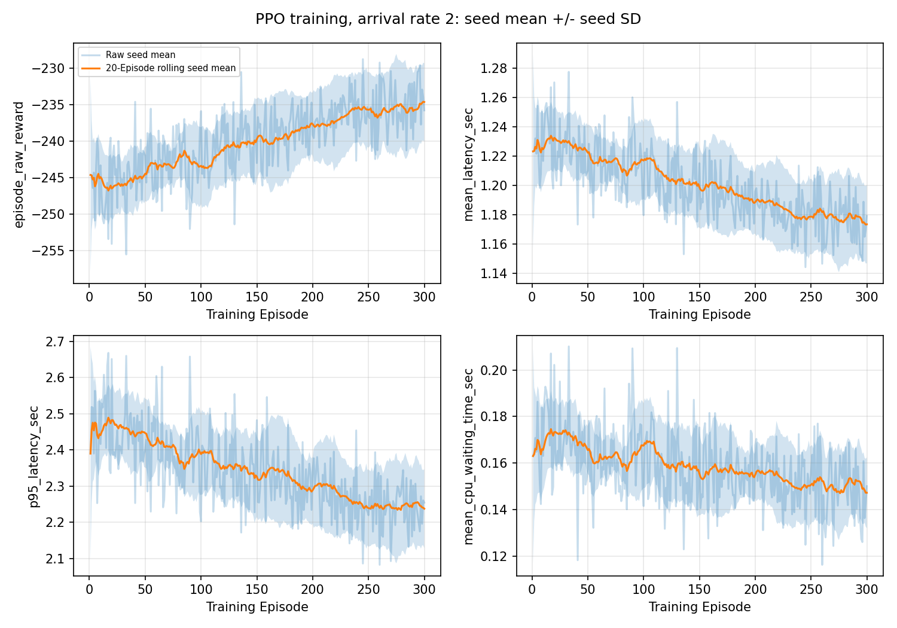
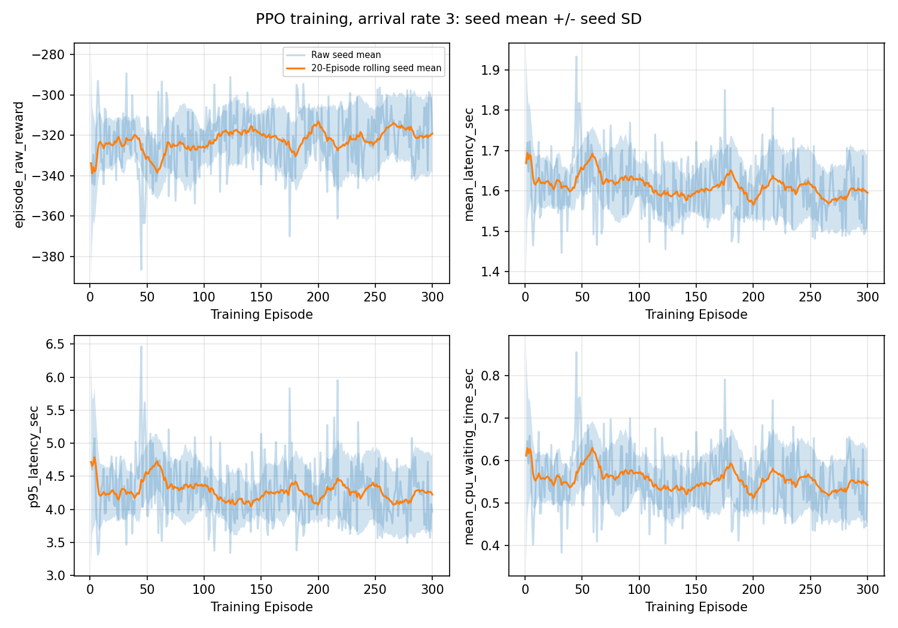
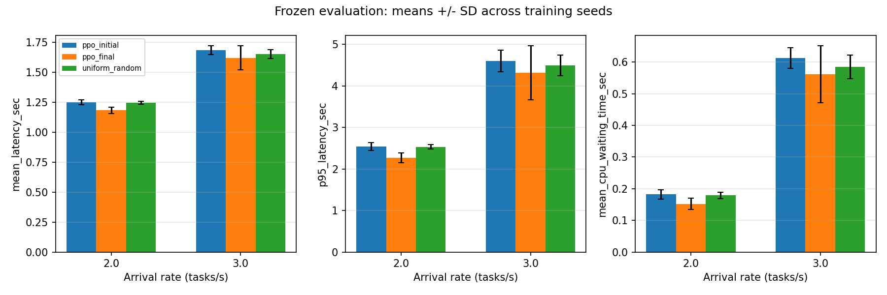
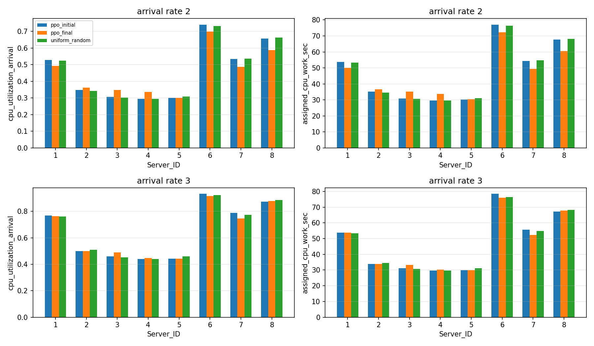
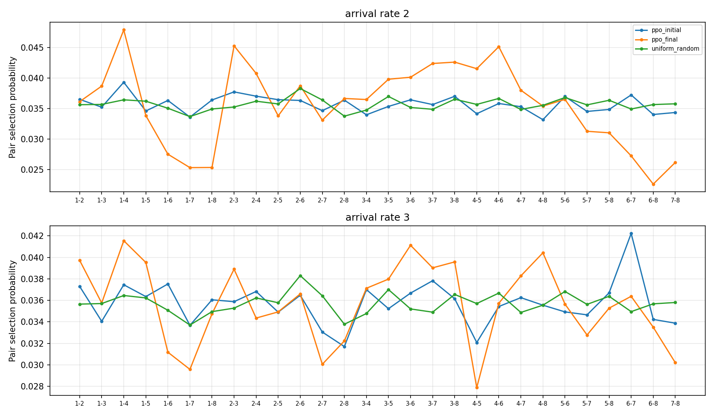

# Step 6：PPO 与 Uniform Random 延迟学习能力对比

基准：`main@a656fb1b5c607e2146d1b7cd9c48f915e0e1462a`。本目录为 完整正式实验。

## 实验设置

主种子=2026；到达率 2.0/3.0；每率 10 独立训练种子，每种子 300 训练 Episode 和 20 评估 Episode。每 Episode 200 个任务、400 副本。
训练用 data/task_parameters.xlsx；评估仅用 data/task_parameters_evaluation.xlsx；服务器固定为 data/server_info.xlsx。设备=cpu（CPU），CPU threads=1。
Python 3.10.19；PyTorch 2.10.0+cu130，CUDA build 13.0；NumPy 2.2.6，pandas 2.3.3，matplotlib 3.10.8。
torch.use_deterministic_algorithms(True)，cuDNN benchmark=False，CUBLAS_WORKSPACE_CONFIG=:4096:8。GPU 逐位复现的实测范围是同设备/同依赖下的重复 smoke；没有把 manual_seed 本身作为 GPU 确定性的证明。
每个 arrival_rate×seed 都新建 PPO；网络初始化、Torch 动作、NumPy shuffle 分别设置以下独立派生种子。没有继承另一到达率或种子的权重。

| arrival_rate | seed_id | training_seed | init_seed | action_seed | shuffle_seed |
| --- | --- | --- | --- | --- | --- |
| 2 | 1 | 15680195 | 284347447 | 932709484 | 3543933231 |
| 2 | 2 | 474021501 | 789500342 | 3770488828 | 3371969127 |
| 2 | 3 | 4097530776 | 51725450 | 3903888620 | 1958549780 |
| 2 | 4 | 2423562689 | 1966468994 | 3064050483 | 3479622191 |
| 2 | 5 | 626614824 | 3057478479 | 1300820807 | 1422991632 |
| 2 | 6 | 4082006996 | 395855714 | 2976150969 | 3096834551 |
| 2 | 7 | 3723124004 | 2525501950 | 1237425610 | 2454721053 |
| 2 | 8 | 476617230 | 2084692074 | 3350774176 | 2189024021 |
| 2 | 9 | 3007385171 | 2394135249 | 3066487121 | 1155863471 |
| 2 | 10 | 3714792343 | 3457191657 | 3198086566 | 1734726214 |
| 3 | 1 | 15680195 | 1137810651 | 791629096 | 3394750389 |
| 3 | 2 | 474021501 | 1174413940 | 1083203095 | 400704031 |
| 3 | 3 | 4097530776 | 3102438083 | 2075550929 | 66331437 |
| 3 | 4 | 2423562689 | 2942206723 | 2095421471 | 983490801 |
| 3 | 5 | 626614824 | 752989868 | 1994567310 | 2654459768 |
| 3 | 6 | 4082006996 | 3828681658 | 2131917118 | 2564454443 |
| 3 | 7 | 3723124004 | 836484293 | 621279946 | 3519233277 |
| 3 | 8 | 476617230 | 3680077646 | 978266491 | 3372509789 |
| 3 | 9 | 3007385171 | 1272244038 | 716166762 | 3979437019 |
| 3 | 10 | 3714792343 | 3161696181 | 3419680879 | 2745267644 |

训练环境由 (6,2,rate_index,seed_id,episode,role) 派生，role=0 到达、1 风险；未消费 MainLoop 默认环境 RNG。
评估由 (6,3,seed_id,episode,role) 派生，role=0 到达、1 风险、2 Random 动作、3 PPO 动作种子。相同编号环境也在两到达率之间 CRN 配对，再按速率缩放。
初始/最终 PPO 使用相同冻结采样种子作诊断；Random 动作用独立 NumPy 流，与 PPO 的 Torch 流不同。
PPO 超参数和归一化尺度均保留：41 状态、28 动作、[64,32]/tanh、actor LR=1e-4、critic LR=5e-4、clip=0.2、epochs=2、batch=64、entropy=0.01、gamma=0.90、GAE=0.95、value_coef=0.5、grad_norm=0.5、reward_scale=1。
gamma_k=gamma**delta_t；训练使用原 MainLoop completion-event interval reward。每轮原始奖励和=-全部任务延迟和；保留终止 transition 与原 PPO 更新流程。
每个种子保存初始与最后训练更新后的 checkpoint；正式主结果使用 ppo_final stochastic sampling，不选 best checkpoint、不调参。

## 训练更新验证

| arrival_rate | seed_id | episodes | transitions | policy_optimizer_steps | value_optimizer_steps | actor_change_from_initial_l2 | min_actor_update_l2 | min_critic_update_l2 |
| --- | --- | --- | --- | --- | --- | --- | --- | --- |
| 2 | 1 | 300 | 60000 | 2400 | 2400 | 0.78046757 | 0.0040063765 | 0.0074664443 |
| 2 | 2 | 300 | 60000 | 2400 | 2400 | 0.82344943 | 0.0054679317 | 0.0063751331 |
| 2 | 3 | 300 | 60000 | 2400 | 2400 | 0.70012957 | 0.0038113161 | 0.011263612 |
| 2 | 4 | 300 | 60000 | 2400 | 2400 | 0.75836551 | 0.0040839878 | 0.0069283568 |
| 2 | 5 | 300 | 60000 | 2400 | 2400 | 0.78552288 | 0.0042305156 | 0.0061824187 |
| 2 | 6 | 300 | 60000 | 2400 | 2400 | 0.70184958 | 0.0039140065 | 0.0054390565 |
| 2 | 7 | 300 | 60000 | 2400 | 2400 | 0.70425367 | 0.0040003397 | 0.0064663985 |
| 2 | 8 | 300 | 60000 | 2400 | 2400 | 0.78839481 | 0.0038939661 | 0.012694523 |
| 2 | 9 | 300 | 60000 | 2400 | 2400 | 0.87014306 | 0.0047572334 | 0.011589052 |
| 2 | 10 | 300 | 60000 | 2400 | 2400 | 0.91995829 | 0.0032041557 | 0.0092104133 |
| 3 | 1 | 300 | 60000 | 2400 | 2400 | 0.71135801 | 0.0047588549 | 0.0015698668 |
| 3 | 2 | 300 | 60000 | 2400 | 2400 | 0.68210053 | 0.0030251117 | 0.0058935382 |
| 3 | 3 | 300 | 60000 | 2400 | 2400 | 0.64271343 | 0.0026402534 | 0.0036576977 |
| 3 | 4 | 300 | 60000 | 2400 | 2400 | 0.8159523 | 0.00424744 | 0.0032640994 |
| 3 | 5 | 300 | 60000 | 2400 | 2400 | 0.66067261 | 0.0045834142 | 0.0038332986 |
| 3 | 6 | 300 | 60000 | 2400 | 2400 | 0.7726438 | 0.0047203382 | 0.0013641909 |
| 3 | 7 | 300 | 60000 | 2400 | 2400 | 0.58644629 | 0.005894538 | 0.0033456297 |
| 3 | 8 | 300 | 60000 | 2400 | 2400 | 0.59244323 | 0.0036371814 | 0.006671879 |
| 3 | 9 | 300 | 60000 | 2400 | 2400 | 0.62640965 | 0.0055905557 | 0.0036379662 |
| 3 | 10 | 300 | 60000 | 2400 | 2400 | 0.5799439 | 0.003484783 | 0.0042397096 |

每轮 200 transitions、8 次 actor 和 8 次 critic optimizer steps（2 epochs×4 minibatches），一次 train_step。检查非零/有限梯度、参数变化、policy_old 同步及 buffer 清空。
原始训练数据与 28 动作频数保留在 train_episode_metrics.csv；平滑窗口固定 20，仅用于绘图，不修改学习。
训练表 method=ppo_final 标识最终 checkpoint 所属的训练运行；训练期间策略持续更新，不代表使用冻结最终策略训练。





## 独立冻结评估：跨训练种子 Mean ± SD

先对每种子 20 个 Episode 的指标求平均，再汇总 10 个种子。P95 始终先在单 Episode 的 200 任务内计算。

| arrival_rate | method | mean_latency_sec | p95_latency_sec | mean_upload_time_sec | mean_cpu_waiting_time_sec | mean_cpu_execution_time_sec | episode_raw_reward | overall_rsr | mean_pair_reliability | pair_hhi | rsr_0_9 | rsr_0_99 | rsr_0_999 | rsr_0_9999 |
| --- | --- | --- | --- | --- | --- | --- | --- | --- | --- | --- | --- | --- | --- | --- |
| 2 | ppo_final | 1.182662 ± 0.027190738 | 2.2673607 ± 0.12047699 | 0.30523748 ± 0.0035635866 | 0.15178968 ± 0.017923643 | 0.72563479 ± 0.010645134 | -236.53239 ± 5.4381475 | 0.99905 ± 0.00080622577 | 0.9999907 ± 9.1037953e-07 | 0.04379775 ± 0.0013879674 | 1 ± 0 | 1 ± 0 | 1 ± 0 | 0.9962 ± 0.0032249031 |
| 2 | ppo_initial | 1.2499857 ± 0.020281372 | 2.5392713 ± 0.09115923 | 0.3102733 ± 0.0016866453 | 0.18230425 ± 0.014560127 | 0.75740815 ± 0.0068136341 | -249.99714 ± 4.0562745 | 0.998725 ± 0.0010765815 | 0.9999902 ± 9.5913225e-07 | 0.04113225 ± 0.00041055425 | 1 ± 0 | 1 ± 0 | 1 ± 0 | 0.9949 ± 0.0043063261 |
| 2 | uniform_random | 1.2448282 ± 0.01087006 | 2.5321134 ± 0.052481454 | 0.31013617 ± 0.00079875598 | 0.17906028 ± 0.010471209 | 0.75563174 ± 0.0021001134 | -248.96564 ± 2.1740121 | 0.99855 ± 0.0012236103 | 0.99999017 ± 1.0147997e-06 | 0.04061025 ± 0.00019899906 | 1 ± 0 | 1 ± 0 | 1 ± 0 | 0.9942 ± 0.0048944413 |
| 3 | ppo_final | 1.6199591 ± 0.10114563 | 4.3129503 ± 0.65287686 | 0.31113436 ± 0.0029375929 | 0.56114941 ± 0.090294695 | 0.74767537 ± 0.0097473822 | -323.99183 ± 20.229127 | 0.9989 ± 0.0010814085 | 0.99999026 ± 9.7310272e-07 | 0.0433295 ± 0.0010106686 | 1 ± 0 | 1 ± 0 | 1 ± 0 | 0.9956 ± 0.0043256342 |
| 3 | ppo_initial | 1.6829427 ± 0.037117586 | 4.6023219 ± 0.25886751 | 0.31309448 ± 0.0022309029 | 0.61266859 ± 0.032614815 | 0.75717964 ± 0.0057320973 | -336.58854 ± 7.4235173 | 0.998775 ± 0.001057053 | 0.99999014 ± 1.0310405e-06 | 0.0413175 ± 0.00027254205 | 1 ± 0 | 1 ± 0 | 1 ± 0 | 0.9951 ± 0.0042282121 |
| 3 | uniform_random | 1.6516192 ± 0.038325545 | 4.496653 ± 0.24717961 | 0.31295057 ± 0.00085319647 | 0.58441796 ± 0.037492638 | 0.75425066 ± 0.0016703623 | -330.32384 ± 7.665109 | 0.99855 ± 0.0012236103 | 0.99999017 ± 1.0147997e-06 | 0.04061025 ± 0.00019899906 | 1 ± 0 | 1 ± 0 | 1 ± 0 | 0.9942 ± 0.0048944413 |

## 配对比较：ppo_final − reference

每个 seed 内同环境配对；95% t CI 使用种子数量作自由度，正式 n=10、df=9，绝不将 200 Episodes 当作 200 个独立训练种子。
时延改善率先算各 seed 的 (reference-PPO)/reference×100，再平均；奖励越大越好，时延越小越好。非时延指标的改善率栏不适用。

| arrival_rate | reference_method | metric | seed_count | ppo_mean | ppo_sd | reference_mean | reference_sd | paired_mean_difference | paired_difference_sd | ci95_lower | ci95_upper | ppo_better_seed_count | improvement_mean_pct |
| --- | --- | --- | --- | --- | --- | --- | --- | --- | --- | --- | --- | --- | --- |
| 2 | uniform_random | mean_latency_sec | 10 | 1.182662 | 0.027190738 | 1.2448282 | 0.01087006 | -0.062166244 | 0.028038159 | -0.082223534 | -0.042108953 | 10 | 4.9895287 |
| 2 | uniform_random | p95_latency_sec | 10 | 2.2673607 | 0.12047699 | 2.5321134 | 0.052481454 | -0.26475276 | 0.13925072 | -0.36436673 | -0.1651388 | 10 | 10.406468 |
| 2 | uniform_random | mean_cpu_waiting_time_sec | 10 | 0.15178968 | 0.017923643 | 0.17906028 | 0.010471209 | -0.027270599 | 0.018572994 | -0.040556919 | -0.01398428 | 9 | 15.092088 |
| 2 | uniform_random | episode_raw_reward | 10 | -236.53239 | 5.4381475 | -248.96564 | 2.1740121 | 12.433249 | 5.6076318 | 8.4217906 | 16.444707 | 10 | — |
| 2 | uniform_random | overall_rsr | 10 | 0.99905 | 0.00080622577 | 0.99855 | 0.0012236103 | 0.0005 | 0.00082495791 | -9.0139339e-05 | 0.0010901393 | 6 | — |
| 2 | ppo_initial | mean_latency_sec | 10 | 1.182662 | 0.027190738 | 1.2499857 | 0.020281372 | -0.067323737 | 0.019983731 | -0.081619237 | -0.053028237 | 10 | 5.3852324 |
| 2 | ppo_initial | p95_latency_sec | 10 | 2.2673607 | 0.12047699 | 2.5392713 | 0.09115923 | -0.27191067 | 0.085397455 | -0.33300033 | -0.21082101 | 10 | 10.712481 |
| 2 | ppo_initial | mean_cpu_waiting_time_sec | 10 | 0.15178968 | 0.017923643 | 0.18230425 | 0.014560127 | -0.030514562 | 0.010502035 | -0.038027265 | -0.023001858 | 10 | 16.830559 |
| 2 | ppo_initial | episode_raw_reward | 10 | -236.53239 | 5.4381475 | -249.99714 | 4.0562745 | 13.464747 | 3.9967462 | 10.605647 | 16.323847 | 10 | — |
| 2 | ppo_initial | overall_rsr | 10 | 0.99905 | 0.00080622577 | 0.998725 | 0.0010765815 | 0.000325 | 0.00037360853 | 5.7736558e-05 | 0.00059226344 | 7 | — |
| 3 | uniform_random | mean_latency_sec | 10 | 1.6199591 | 0.10114563 | 1.6516192 | 0.038325545 | -0.03166006 | 0.11949659 | -0.11714277 | 0.053822648 | 6 | 1.8262873 |
| 3 | uniform_random | p95_latency_sec | 10 | 4.3129503 | 0.65287686 | 4.496653 | 0.24717961 | -0.18370269 | 0.73852622 | -0.71201252 | 0.34460715 | 6 | 3.6885876 |
| 3 | uniform_random | mean_cpu_waiting_time_sec | 10 | 0.56114941 | 0.090294695 | 0.58441796 | 0.037492638 | -0.023268556 | 0.10856711 | -0.10093279 | 0.054395678 | 6 | 3.3208845 |
| 3 | uniform_random | episode_raw_reward | 10 | -323.99183 | 20.229127 | -330.32384 | 7.665109 | 6.332012 | 23.899317 | -10.76453 | 23.428554 | 6 | — |
| 3 | uniform_random | overall_rsr | 10 | 0.9989 | 0.0010814085 | 0.99855 | 0.0012236103 | 0.00035 | 0.00075645371 | -0.00019113439 | 0.00089113439 | 6 | — |
| 3 | ppo_initial | mean_latency_sec | 10 | 1.6199591 | 0.10114563 | 1.6829427 | 0.037117586 | -0.062983567 | 0.082608016 | -0.12207778 | -0.0038893529 | 8 | 3.7768961 |
| 3 | ppo_initial | p95_latency_sec | 10 | 4.3129503 | 0.65287686 | 4.6023219 | 0.25886751 | -0.2893716 | 0.51417979 | -0.65719367 | 0.078450461 | 8 | 6.5167445 |
| 3 | ppo_initial | mean_cpu_waiting_time_sec | 10 | 0.56114941 | 0.090294695 | 0.61266859 | 0.032614815 | -0.051519182 | 0.073320962 | -0.10396984 | 0.00093147471 | 8 | 8.644506 |
| 3 | ppo_initial | episode_raw_reward | 10 | -323.99183 | 20.229127 | -336.58854 | 7.4235173 | 12.596713 | 16.521603 | 0.77787057 | 24.415556 | 8 | — |
| 3 | ppo_initial | overall_rsr | 10 | 0.9989 | 0.0010814085 | 0.998775 | 0.001057053 | 0.000125 | 0.00035843022 | -0.00013140553 | 0.00038140553 | 4 | — |



## 服务器与动作行为

每台服务器被选中 probability 为含该服务器的任务比例（分母为任务数），8 个概率合计为 2；pair probability 合计为 1。





### 到达率 2

最终−Random 平均延迟差 -0.062166244 s，95% CI [-0.082223534, -0.042108953]；优于 Random 种子数 10/10。
最终−初始策略差 -0.067323737 s，95% CI [-0.081619237, -0.053028237]。权重变化本身不等于性能提升。
ppo_initial 最常选的服务器对：

| server_a | server_b | probability |
| --- | --- | --- |
| 1 | 4 | 0.039325 |
| 2 | 3 | 0.03775 |
| 6 | 7 | 0.03725 |
| 2 | 4 | 0.03705 |
| 3 | 8 | 0.037025 |

ppo_final 最常选的服务器对：

| server_a | server_b | probability |
| --- | --- | --- |
| 1 | 4 | 0.0479 |
| 2 | 3 | 0.0453 |
| 4 | 6 | 0.04515 |
| 3 | 8 | 0.042625 |
| 3 | 7 | 0.0424 |

uniform_random 最常选的服务器对：

| server_a | server_b | probability |
| --- | --- | --- |
| 2 | 6 | 0.0383 |
| 3 | 5 | 0.037 |
| 5 | 6 | 0.036825 |
| 4 | 6 | 0.036675 |
| 3 | 8 | 0.03655 |

服务器指标先按种子汇总后的总体均值；完整每 Episode 数值见 eval_server_metrics.csv。

| method | server_id | cpu_utilization_arrival | cpu_utilization_full | mean_waiting_queue_length | max_waiting_queue_length | waiting_queue_length_at_last_arrival | replica_count | assigned_cpu_work_sec |
| --- | --- | --- | --- | --- | --- | --- | --- | --- |
| ppo_final | 1 | 0.49264957 | 0.48399672 | 0.29732221 | 3.07 | 0.13 | 46.98 | 50.011658 |
| ppo_final | 2 | 0.36215606 | 0.35342096 | 0.12927495 | 2.6 | 0.11 | 52.92 | 36.527009 |
| ppo_final | 3 | 0.34780994 | 0.3395067 | 0.10934243 | 2.485 | 0.15 | 57.1 | 35.123896 |
| ppo_final | 4 | 0.33648265 | 0.32751521 | 0.097125024 | 2.46 | 0.095 | 57.065 | 33.833113 |
| ppo_final | 5 | 0.30112838 | 0.29365296 | 0.075189802 | 2.105 | 0.07 | 49.59 | 30.416685 |
| ppo_final | 6 | 0.69849062 | 0.69709566 | 0.92092837 | 4.625 | 1.045 | 47.61 | 72.306894 |
| ppo_final | 7 | 0.48708979 | 0.47780754 | 0.28994455 | 3.1 | 0.235 | 44.735 | 49.494045 |
| ppo_final | 8 | 0.58885979 | 0.5839871 | 0.53851357 | 3.72 | 0.565 | 44 | 60.467062 |
| ppo_initial | 1 | 0.52893011 | 0.51645063 | 0.36622663 | 3.345 | 0.21 | 50.425 | 53.697059 |
| ppo_initial | 2 | 0.3482793 | 0.3378196 | 0.11490626 | 2.445 | 0.115 | 51.045 | 35.144378 |
| ppo_initial | 3 | 0.30634275 | 0.29684342 | 0.080001804 | 2.24 | 0.11 | 50.305 | 30.921306 |
| ppo_initial | 4 | 0.29380993 | 0.28399616 | 0.068908966 | 2.145 | 0.075 | 49.785 | 29.556884 |
| ppo_initial | 5 | 0.29997818 | 0.29046933 | 0.072652252 | 2.15 | 0.08 | 49.415 | 30.266349 |
| ppo_initial | 6 | 0.74098939 | 0.73862572 | 1.1222915 | 5.065 | 1.385 | 50.66 | 77.058905 |
| ppo_initial | 7 | 0.53404253 | 0.52164795 | 0.37951562 | 3.47 | 0.305 | 49.095 | 54.359645 |
| ppo_initial | 8 | 0.65727545 | 0.65037771 | 0.7350695 | 4.315 | 0.84 | 49.27 | 67.78547 |
| uniform_random | 1 | 0.52403796 | 0.5119644 | 0.33534806 | 3.345 | 0.275 | 49.55 | 53.353512 |
| uniform_random | 2 | 0.34184071 | 0.33176829 | 0.10497883 | 2.425 | 0.145 | 50.285 | 34.553099 |
| uniform_random | 3 | 0.30368517 | 0.29403194 | 0.074852852 | 2.185 | 0.065 | 49.88 | 30.629623 |
| uniform_random | 4 | 0.29488728 | 0.28519684 | 0.072671898 | 2.215 | 0.09 | 50.05 | 29.678735 |
| uniform_random | 5 | 0.30842564 | 0.29881362 | 0.080959483 | 2.235 | 0.07 | 50.705 | 31.094089 |
| uniform_random | 6 | 0.73345686 | 0.73246542 | 1.1818148 | 5.2 | 1.45 | 50.54 | 76.318079 |
| uniform_random | 7 | 0.53720827 | 0.52590513 | 0.39191401 | 3.46 | 0.385 | 49.255 | 54.73001 |
| uniform_random | 8 | 0.66226623 | 0.65424501 | 0.71948615 | 4.37 | 0.895 | 49.735 | 68.145251 |

8 台服务器平均分配 CPU 工作量的横截面 CV（总体 SD/均值）由 Random 的 0.3647 变为 PPO 的 0.3003；这是描述性负载指标，不是种子级显著性检验。
server6：CPU 工作量 76.318→72.307 s，时间加权等待队列 1.182→0.921。
server8：CPU 工作量 68.145→60.467 s，时间加权等待队列 0.719→0.539。
跨种子汇总最高服务器对频率 4.79%；结合逐种子动作分布与 HHI，未见所有种子共同塌缩到单一服务器对。每 Episode 200 次均匀抽样的经验 HHI 期望为 1/28+(1−1/28)/200≈0.04054，不能把有限样本 HHI 高于 1/28 本身视为学习证据。

最终策略在本轮种子级配对独立评估中优于 Random。
最终策略的平均延迟相对初始策略有改善证据。该诊断不用于 checkpoint 选择；非均匀动作和参数变化也不能单独证明有效学习。

### 到达率 3

最终−Random 平均延迟差 -0.03166006 s，95% CI [-0.11714277, 0.053822648]；优于 Random 种子数 6/10。
最终−初始策略差 -0.062983567 s，95% CI [-0.12207778, -0.0038893529]。权重变化本身不等于性能提升。
ppo_initial 最常选的服务器对：

| server_a | server_b | probability |
| --- | --- | --- |
| 6 | 7 | 0.042225 |
| 3 | 7 | 0.037825 |
| 1 | 6 | 0.037525 |
| 1 | 4 | 0.03745 |
| 1 | 2 | 0.0373 |

ppo_final 最常选的服务器对：

| server_a | server_b | probability |
| --- | --- | --- |
| 1 | 4 | 0.04155 |
| 3 | 6 | 0.041125 |
| 4 | 8 | 0.040425 |
| 1 | 2 | 0.039725 |
| 3 | 8 | 0.039575 |

uniform_random 最常选的服务器对：

| server_a | server_b | probability |
| --- | --- | --- |
| 2 | 6 | 0.0383 |
| 3 | 5 | 0.037 |
| 5 | 6 | 0.036825 |
| 4 | 6 | 0.036675 |
| 3 | 8 | 0.03655 |

服务器指标先按种子汇总后的总体均值；完整每 Episode 数值见 eval_server_metrics.csv。

| method | server_id | cpu_utilization_arrival | cpu_utilization_full | mean_waiting_queue_length | max_waiting_queue_length | waiting_queue_length_at_last_arrival | replica_count | assigned_cpu_work_sec |
| --- | --- | --- | --- | --- | --- | --- | --- | --- |
| ppo_final | 1 | 0.76482662 | 0.64349843 | 1.5620738 | 5.615 | 1.875 | 50.41 | 53.809536 |
| ppo_final | 2 | 0.50067154 | 0.40794026 | 0.36135849 | 3.39 | 0.36 | 49.355 | 33.949526 |
| ppo_final | 3 | 0.48978261 | 0.39835042 | 0.28379021 | 3.245 | 0.295 | 53.895 | 33.218005 |
| ppo_final | 4 | 0.44750749 | 0.36160894 | 0.20719752 | 2.89 | 0.2 | 51.065 | 30.233245 |
| ppo_final | 5 | 0.44111834 | 0.35634824 | 0.20539021 | 2.835 | 0.16 | 48.8 | 29.829151 |
| ppo_final | 6 | 0.91530467 | 0.89509522 | 5.0149172 | 11.335 | 8.96 | 50.03 | 76.00328 |
| ppo_final | 7 | 0.74661215 | 0.62468088 | 1.2947742 | 5.455 | 1.52 | 47.255 | 52.25794 |
| ppo_final | 8 | 0.87756197 | 0.80724259 | 3.4828855 | 8.865 | 5.855 | 49.19 | 67.860031 |
| ppo_initial | 1 | 0.76831122 | 0.64239701 | 1.5242193 | 5.695 | 1.75 | 50.48 | 53.861367 |
| ppo_initial | 2 | 0.50066217 | 0.40425082 | 0.3466505 | 3.37 | 0.275 | 49.225 | 33.914642 |
| ppo_initial | 3 | 0.4593542 | 0.37184952 | 0.23825732 | 3.01 | 0.25 | 50.56 | 31.114423 |
| ppo_initial | 4 | 0.44028248 | 0.35368841 | 0.19223713 | 2.785 | 0.14 | 50.115 | 29.697647 |
| ppo_initial | 5 | 0.44299888 | 0.35704336 | 0.20504456 | 2.88 | 0.16 | 48.965 | 29.945315 |
| ppo_initial | 6 | 0.93192413 | 0.92346934 | 5.4264263 | 12.02 | 9.675 | 51.495 | 78.411252 |
| ppo_initial | 7 | 0.78756719 | 0.66286173 | 1.6509433 | 6.125 | 2.07 | 50.31 | 55.64705 |
| ppo_initial | 8 | 0.87362538 | 0.79701924 | 3.23572 | 8.605 | 5.61 | 48.85 | 67.160112 |
| uniform_random | 1 | 0.76221304 | 0.64448249 | 1.3527408 | 5.56 | 1.555 | 49.55 | 53.353512 |
| uniform_random | 2 | 0.5089359 | 0.41702863 | 0.30963489 | 3.265 | 0.305 | 50.285 | 34.553099 |
| uniform_random | 3 | 0.45297587 | 0.36986047 | 0.21359611 | 2.915 | 0.15 | 49.88 | 30.629623 |
| uniform_random | 4 | 0.43964816 | 0.3584626 | 0.2015613 | 2.885 | 0.215 | 50.05 | 29.678735 |
| uniform_random | 5 | 0.45940256 | 0.37517945 | 0.2318853 | 3.045 | 0.175 | 50.705 | 31.094089 |
| uniform_random | 6 | 0.92423314 | 0.91269767 | 5.0355103 | 11.25 | 8.6 | 50.54 | 76.318079 |
| uniform_random | 7 | 0.77308905 | 0.66077136 | 1.5967422 | 5.78 | 2.23 | 49.255 | 54.73001 |
| uniform_random | 8 | 0.88680613 | 0.81998242 | 3.3354341 | 8.78 | 5.75 | 49.735 | 68.145251 |

8 台服务器平均分配 CPU 工作量的横截面 CV（总体 SD/均值）由 Random 的 0.3647 变为 PPO 的 0.3586；这是描述性负载指标，不是种子级显著性检验。
server6：CPU 工作量 76.318→76.003 s，时间加权等待队列 5.036→5.015。
server8：CPU 工作量 68.145→67.860 s，时间加权等待队列 3.335→3.483。
跨种子汇总最高服务器对频率 4.15%；结合逐种子动作分布与 HHI，未见所有种子共同塌缩到单一服务器对。每 Episode 200 次均匀抽样的经验 HHI 期望为 1/28+(1−1/28)/200≈0.04054，不能把有限样本 HHI 高于 1/28 本身视为学习证据。

本轮最终策略相对 Random 的种子级置信区间包含零，未得到明确改善证据。
最终策略的平均延迟相对初始策略有改善证据。该诊断不用于 checkpoint 选择；非均匀动作和参数变化也不能单独证明有效学习。

## 验证边界与遗留事项

冻结评估仅用 select_action 与共享 Step 5 物理过程；不 store_transition、不 train_step、不 backward。模型/optimizer/rollout 快照前后完全一致，Torch 动作 RNG 由 fork_rng 保存恢复。
逐场景检查 PPO/Random/初始策略的任务属性、到达时间、风险场与有效故障率一致。全部副本排空，按同一时间戳口径统计 CPU 忙碌区间和队列。
RSR 是理论可靠性要求满足率，不是实际失败事件成功率；本轮不使用可靠性 mask/penalty/constrained PPO、不校准可靠性参数、不研究独立风险场泛化。
若未改善，只提出下一轮单因素诊断：区间奖励的动作信用分配、遗漏在途副本的部分可观测性、动作集中与 CPU 工作量分配。此次不修改这些因素，也不根据评估结果调参。

## 本次实际运行核验记录

当前 conda 的 PyTorch 为 2.10.0+cu130，CUDA 13.0；解除沙箱设备访问限制后识别 NVIDIA GeForce RTX 5060。CPU 与 CUDA smoke 均执行两次，全部六张 CSV 及初始/最终 checkpoint（含 optimizer 状态）同设备逐位一致。CPU smoke 每率约 0.3–0.4 s，CUDA 约 1.3–2.5 s，因此正式实验使用单线程 CPU。

命令（python 为 /home/user/anaconda3/envs/DRL-reliable-offloading-simulator/bin/python）：

```bash
python tools/compare_ppo_random.py --smoke --device cpu --output-dir /tmp/drl-step6-cpu-smoke
python tools/compare_ppo_random.py --smoke --device cpu --output-dir /tmp/drl-step6-cpu-repeat
python tools/compare_ppo_random.py --smoke --device cuda --output-dir /tmp/drl-step6-cuda-smoke
python tools/compare_ppo_random.py --smoke --device cuda --output-dir /tmp/drl-step6-cuda-repeat
python tools/compare_ppo_random.py --device cpu
```

正式结果包含 6000 训练、400 最终 PPO、400 Random、400 初始策略诊断 Episode，9600 条服务器记录及 40 个 checkpoint。总计 120 万 transitions；actor/critic 各 48000 optimizer steps。另通过临时目录调用同一 run_experiment，完整重跑两个到达率的 seed1（各 300 训练、20 场景×3 方法评估）；CSV 数值与初始/最终 checkpoint 全部逐位一致。未把其余九个种子宣称为完整重跑。

再次独立核对输出行数、每轮动作计数 200、服务器副本合计 400、reward=−200×平均延迟、有限数值及种子级配对 CI；均通过。Step 5 默认入口在两个到达率的前三个 Episode 与原有结果相符，差异在 1e−12 内；git diff --check 通过。
