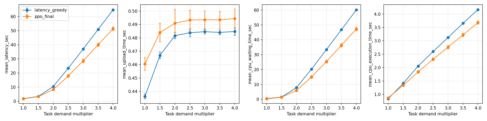
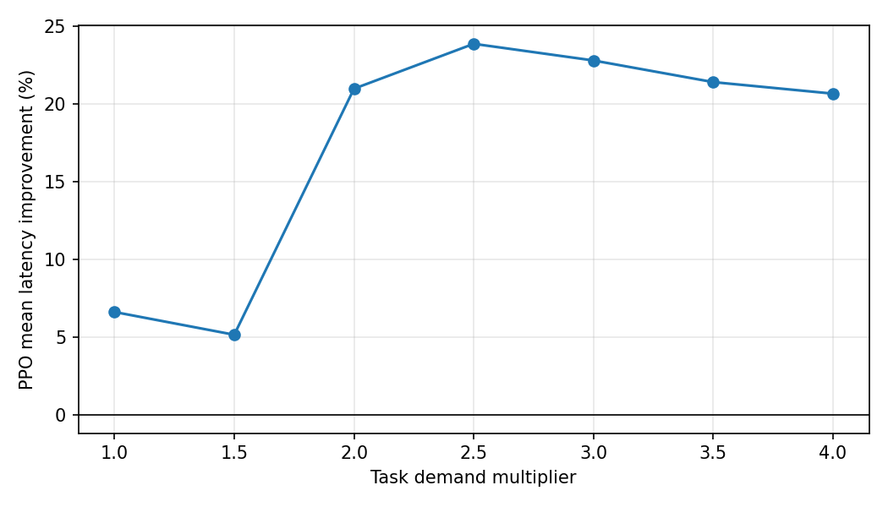

# 任务计算需求倍率：PPO与Latency Greedy平均延迟对比

到达率固定2 tasks/s；每档10种子×300训练轮×20评估轮。
每档从头初始化、独立训练到最后一轮后冻结，PPO按概率采样，不选模型、不调参。各倍率同seed共享初始权重及动作/shuffle/到达/空间场的随机流。
训练和评估分别复用独立固定的200任务。只有Computation_Demand乘倍率k；任务大小、顺序、服务器和可靠性要求保持不变，Excel不改写。
42维，CPU 1–4 GHz，上传5–20 MB/s，基础需求2–4×10⁹ cycles；需求min–max范围固定为(2000000000.0, 4000000000.0)。运行与等待工作量均用原始秒数，不压缩、不裁剪、不随k调整输入映射。
gamma=0.8（按秒折扣），GAE lambda=0.95，单任务负延迟回填，空间风险开启=True。可靠性不筛选动作或惩罚奖励。
Greedy使用相同状态还原物理量，预测max(上传,运行＋等待)+执行；按组合的首完成预测、两副本时间之和、编号排序。两方法评估任务、到达和风险场配对；评估不更新网络或优化器。
每种子先平均评估Episode，再按10个种子配对计算t区间；改善率先逐种子算后平均。区间为探索性逐倍率比较，未作多重比较校正。只研究平均延迟及平均上传、等待、执行时间，不计算P95。

| 倍率 | 名义CPU负载 | PPO平均延迟(s) | Greedy平均延迟(s) | 改善率(%) | PPO−Greedy 95% CI(s) |
|---|---:|---:|---:|---:|---|
| 1 | 55.9% | 1.638312 | 1.754121 | 6.601 | [-0.127266, -0.104352] |
| 1.5 | 83.9% | 3.203729 | 3.377058 | 5.137 | [-0.245698, -0.100961] |
| 2 | 111.8% | 8.265938 | 10.449279 | 20.966 | [-2.561256, -1.805424] |
| 2.5 | 139.8% | 17.798987 | 23.367550 | 23.855 | [-6.117407, -5.019719] |
| 3 | 167.8% | 28.604085 | 37.038854 | 22.783 | [-9.077076, -7.792461] |
| 3.5 | 195.7% | 40.020681 | 50.908121 | 21.391 | [-11.600665, -10.174215] |
| 4 | 223.7% | 51.428110 | 64.808138 | 20.649 | [-14.083608, -12.676448] |

名义负载计入两个副本的全部CPU需求。2倍及以上超过总CPU名义容量；所有档均为200任务到达后排空副本的有限任务集结果。

命令：`python scan_task_demand.py`

## 结论与运行核验

七档平均延迟均有改善证据：每档10/10种子更快，PPO−Greedy的配对95%区间均低于零。平均CPU等待时间的区间也均低于零。改善率为逐种子比例的平均，不要求随倍率单调变化。

1倍和1.5倍的名义负载约55.9%和83.9%；2倍及以上为名义过载。本轮结果限定于当前模型、固定200任务Episode和采样策略，不能将过载档改善视为长期稳态能力。

共70个从头训练的模型，21000条训练Episode、2800条冻结评估Episode（每方法1400轮）、140份初始/最终checkpoint、70行种子映射。每模型Actor和Critic各2400次小批次优化。全部42维权重有限，评估网络与优化器不变，动作计数及延迟分解通过检查；28项配对统计独立重算一致。数据、配置、PPO和执行模块哈希未变。

同seed在七档中的初始checkpoint与优化器状态完全一致。1倍完全复现上一轮到达率2.0的3000训练记录、400评估记录、动作计数以及20份初始/最终checkpoint；倍率入口没有改变基础行为。只改变任务cycles，没有修改或重生成Excel。

| 倍率 | PPO平均等待(s) | Greedy平均等待(s) |
|---|---:|---:|
| 1 | 0.308965 | 0.483126 |
| 1.5 | 1.384238 | 1.500380 |
| 2 | 5.934057 | 7.911860 |
| 2.5 | 14.995438 | 20.283845 |
| 3 | 25.345696 | 33.429958 |
| 3.5 | 36.303487 | 46.768629 |
| 4 | 47.255643 | 60.156877 |
