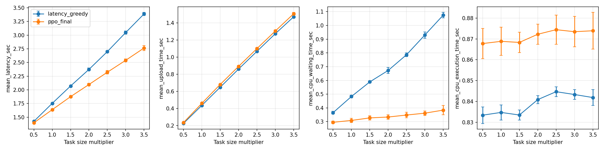
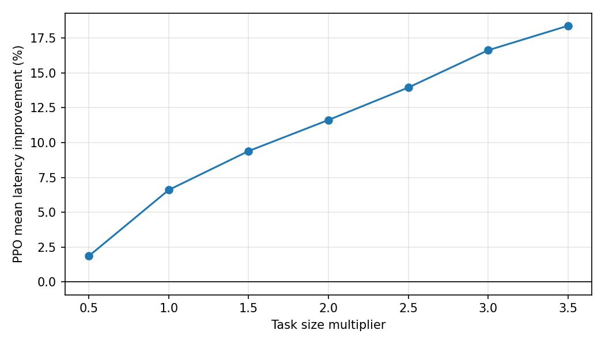

# 任务大小倍率：PPO与Latency Greedy平均延迟对比

到达率固定2 tasks/s；每档10种子×300训练轮×20评估轮。
每档从头初始化、独立训练到最后一轮后冻结，PPO按概率采样，不选模型、不调参。各倍率同seed共享初始权重及动作/shuffle/到达/空间场的随机流。
训练和评估分别复用独立固定的200任务。只有Task_Size乘倍率k；计算需求、任务顺序、服务器和可靠性要求保持不变，Excel不改写。
42维，CPU 1–4 GHz，上传5–20 MB/s，基础需求2–4×10⁹ cycles；大小min–max范围固定为(5.0, 10.0) MB。运行与等待工作量均用原始秒数，不压缩、不裁剪、不随k调整输入映射。
gamma=0.8（按秒折扣），GAE lambda=0.95，单任务负延迟回填，空间风险开启=True。可靠性不筛选动作或惩罚奖励。
Greedy使用相同状态还原物理量，预测max(上传,运行＋等待)+执行；按组合的首完成预测、两副本时间之和、编号排序。两方法评估任务、到达和风险场配对；评估不更新网络或优化器。
每种子先平均评估Episode，再按10个种子配对计算t区间；改善率先逐种子算后平均。区间为探索性逐倍率比较，未作多重比较校正。只研究平均延迟及平均上传、等待、执行时间，不计算P95。

| 倍率 | 名义CPU负载 | PPO平均延迟(s) | Greedy平均延迟(s) | 改善率(%) | PPO−Greedy 95% CI(s) |
|---|---:|---:|---:|---:|---|
| 0.5 | 55.9% | 1.398397 | 1.424945 | 1.857 | [-0.037128, -0.015968] |
| 1 | 55.9% | 1.638312 | 1.754121 | 6.601 | [-0.127266, -0.104352] |
| 1.5 | 55.9% | 1.876479 | 2.071017 | 9.393 | [-0.207363, -0.181713] |
| 2 | 55.9% | 2.097898 | 2.373985 | 11.624 | [-0.295081, -0.257094] |
| 2.5 | 55.9% | 2.322315 | 2.698917 | 13.953 | [-0.396421, -0.356784] |
| 3 | 55.9% | 2.540169 | 3.047044 | 16.631 | [-0.528347, -0.485403] |
| 3.5 | 55.9% | 2.764683 | 3.387676 | 18.388 | [-0.656165, -0.589821] |

各档名义CPU负载相同（约55.9%）；上传速率固定，每个副本独立上传，未建模共享链路带宽竞争。所有档均为200任务到达后排空副本的有限任务集结果。

命令：`python scan_task_size.py`

## 七档结果与增量核验

新增2.5、3、3.5倍的平均延迟改善率分别为13.95%、16.63%、18.39%。七档每档10/10种子平均延迟更低，PPO−Greedy的95%配对区间均低于零；改善率点估计随大小倍率上升，但不表示其他范围下必然单调。

仅补跑新增三档，共30个从头训练模型；原四档的模型和逐轮记录未覆盖。99个受保护文件（原四档文件、Excel、配置和核心运行代码）的哈希保持一致。七档合计70个最终模型、21000训练Episode、2800冻结评估Episode、140份初始/最终checkpoint、70行种子映射。新增模型42维权重有限、Actor/Critic各2400次小批次更新；同seed初始化与原1倍一致。全部28项配对统计独立重算通过，延迟分解、奖励和、动作计数、冻结评估及副本排空检查通过。

完整重跑命令：`python scan_task_size.py`。本次增量执行的是该模块中run_multiplier的2.5、3、3.5三档，再调用summarize合并全部七档；系统配置和Excel没有修改。

| 大小倍率 | PPO平均等待(s) | Greedy平均等待(s) |
|---|---:|---:|
| 0.5 | 0.295606 | 0.365442 |
| 1 | 0.308965 | 0.483126 |
| 1.5 | 0.327418 | 0.589392 |
| 2 | 0.333825 | 0.672565 |
| 2.5 | 0.348217 | 0.786824 |
| 3 | 0.361839 | 0.930479 |
| 3.5 | 0.384131 | 1.075146 |
